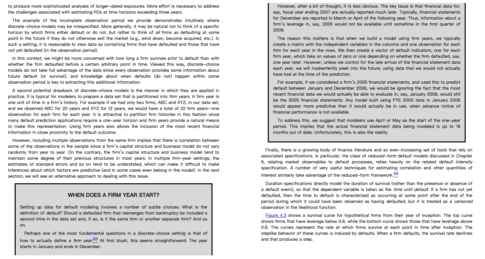

# Labels: status

Code: [notebooks/02_labels.ipynb](../../../notebooks/02_labels.ipynb), function `make_label(df)`.

## Definition
- One row = one financial statement (FY Y). Label = 1 if the firm defaults in the 12 months after the report is published, else 0.
- Assumption: the FY Y report is published at the end of May of Y+1 (`publish_month=5`), so FY2007 -> window 2008-06-01 to 2009-05-31.
- Input: DataFrame with `fs_year`, `def_date`. Output: same DataFrame + `label` (0/1), unlabelable rows dropped.

## Result (`data/train-2025.csv`, 1,023,552 rows)
| FY | Rows | Default rate |
|---|---|---|
| 2007 | 144,251 | 0.87% |
| 2008 | 161,383 | 1.21% |
| 2009 | 170,549 | 1.58% |
| 2010 | 174,674 | 1.65% |
| 2011 | 184,159 | 1.39% |

835,016 rows kept (823,680 zeros, 11,336 ones); 188,536 dropped:
- 185,639: all FY2012. The window (2013-06 to 2014-05) is past the last observed default (2013-05-31), so `def_date = NaN` cannot be read as "no default".
- 2,897: defaulted before the publish date, so the bank could not have used the statement (the default is already captured by the firm's FY Y-1 row when it exists).

## Why May instead of June
- **June loses FY2011.** The last default in the data is 2013-05-31. With June, FY2011's window (2012-07 to 2013-06) is missing the last month, so `def_date = NaN` cannot be read as 0 and the whole year is dropped (650,326 rows left). With May, the window (2012-06 to 2013-05) is fully covered: FY2011 adds 184,159 rows (835,016 total).
- **The textbook allows it.** It suggests starting the one-year prediction period in April or May, accepting financial data up to 18 months old (excerpt below).
- **Italian filing law matches it.** All statements in the data end on Dec 31. Civil Code [art. 2364](https://brocardi.it/codice-civile/libro-quinto/titolo-v/capo-v/sezione-vi/art2364.html) requires approval within 120 days of year-end (Apr 30). [Art. 2435](https://www.brocardi.it/codice-civile/libro-quinto/titolo-v/capo-v/sezione-ix/art2435.html) then requires filing with the Registro delle Imprese within 30 days of approval, so the filing deadline is **May 30** (see also this [practitioner guide](https://www.ecnews.it/fiscale/in-pratica/guida-agli-adempimenti/guida-agli-adempimenti-connessi-allapprovazione-del-bilancio-desercizio-2024/)). The end of May is the date by which a compliant firm's statement is public.
- **Industry practice matches it.** Moody's [RiskCalc 3.1 whitepaper](https://www.moodys.com/sites/products/ProductAttachments/RiskCalc%203.1%20Whitepaper.pdf) (p.16): "most private firm statements are not available to lenders until three or four months after the statement date", i.e. April-May for Dec 31 year-ends.
- Caveat: firms whose bylaws allow the 180-day extension approve by Jun 30 and file by Jul 30. For them, May is slightly early, a small look-ahead. The data has no actual filing date, so May is still an assumption. The proposal's publish-date and observation-period tables should be updated to May.

## To ask the professor: defaults after 2012
`Term Project Instructions 20261011.pdf` (data description) says: *"There is no information in the training data regarding defaults that occurred after 12/31/2012."* But `train-2025.csv` has 5,570 defaults dated 2013-01-01 to 2013-05-31 (monthly counts similar to 2012).

- The May assumption, and FY2011 being usable at all, depends on those post-2012 defaults being real.
- If we must trust the instructions (cutoff 2012-12-31), FY2011 is unlabelable under both May and June, and only FY2007-2010 remain (`make_label(df, cutoff="2012-12-31")`).
- Question: is it OK to use the 2013 default dates in the training data, or should they be ignored?
