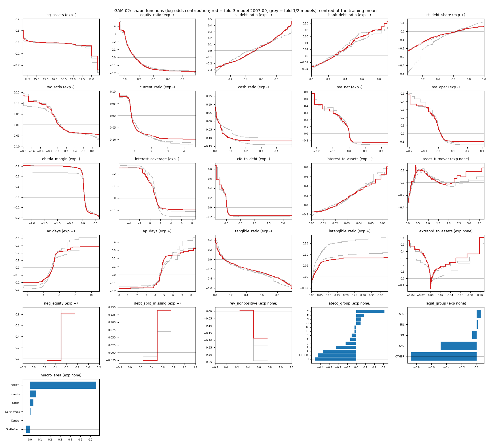
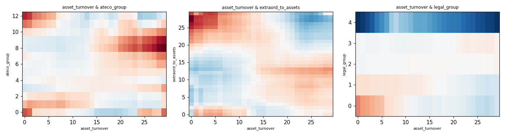

# GAM-02 explainability (fold-3 model: trained on fs_year 2007-2009; explained on a 40,000-row random sample of 2010 test rows)

GAM-01 + 10 pairwise interaction terms (FAST-selected inside the training window). Chosen config {'max_leaves': 3, 'min_samples_leaf': 200}, 36 terms (26 main, 10 pairwise). An EBM is a sum of one lookup table per feature (plus pairs): PD = expit(intercept + sum of term scores) before the Platt/level step, so every firm's log-odds splits exactly into per-feature contributions (checked: the term contributions plus the intercept reproduce the model's log-odds). Method background (cyclic gradient boosting of shape functions, GA2M) is from Lou et al. 2012 and Nori et al. 2019 [UNVERIFIED: R-24/R-25 not verified]; the link to RiskCalc v3.1 as 'closely related to a GAM' is R-01 p. 14 fn. 11.

## 1. Shape functions

Red = the fold-3 model (what this section describes); grey = fold-1 and fold-2 models (shape stability across training windows). x-axes are cut at the training 1st-99th percentile; features marked slog are on a signed-log scale. Each curve is the log-odds contribution, centred at the training average. Missing values have their own score (printed in the table).

Importance = mean |contribution| (log-odds) on the 2010 sample. `against_share` = share of the total variation of the step function that moves AGAINST the expected sign (0 = monotone as expected).

| feature            | expected           |   importance | shape                                                                                                                           |   against_share | verdict           |
|:-------------------|:-------------------|-------------:|:--------------------------------------------------------------------------------------------------------------------------------|----------------:|:------------------|
| tangible_ratio     | -                  |        0.272 | 2nd pct +0.44 / median -0.03 / 98th pct -0.61 log-odds; missing-bin +0.00                                                       |           0.000 | agrees (monotone) |
| ateco_group        | none (categorical) |        0.178 | levels: I -0.46, OTHER -0.42, A -0.37, L -0.23, J -0.12, F -0.07, R -0.05, H -0.02, M -0.02, G +0.05, N +0.05, E +0.08, C +0.31 |         nan     | n/a               |
| st_debt_ratio      | +                  |        0.173 | 2nd pct -0.27 / median -0.02 / 98th pct +0.42 log-odds; missing-bin +0.00                                                       |           0.000 | agrees (monotone) |
| asset_turnover     | none               |        0.163 | 2nd pct -0.47 / median +0.19 / 98th pct +0.18 log-odds; missing-bin +0.00                                                       |         nan     | no expectation    |
| ar_days            | +                  |        0.148 | 2nd pct -0.20 / median -0.06 / 98th pct +0.28 log-odds; missing-bin +0.48                                                       |           0.000 | agrees (monotone) |
| equity_ratio       | -                  |        0.144 | 2nd pct +0.34 / median -0.04 / 98th pct -0.18 log-odds; missing-bin +0.00                                                       |           0.000 | agrees (monotone) |
| cfo_to_debt        | -                  |        0.144 | 2nd pct +0.47 / median -0.06 / 98th pct -0.17 log-odds; missing-bin +0.00                                                       |           0.000 | agrees (monotone) |
| ebitda_margin      | -                  |        0.136 | 2nd pct +0.29 / median -0.04 / 98th pct -0.20 log-odds; missing-bin +0.29                                                       |           0.000 | agrees (monotone) |
| extraord_to_assets | none               |        0.128 | 2nd pct +0.40 / median -0.12 / 98th pct +0.30 log-odds; missing-bin +0.00                                                       |         nan     | no expectation    |
| ap_days            | +                  |        0.125 | 2nd pct -0.17 / median -0.08 / 98th pct +0.30 log-odds; missing-bin +0.01                                                       |           0.000 | agrees (monotone) |
| interest_to_assets | +                  |        0.124 | 2nd pct -0.15 / median -0.08 / 98th pct +0.66 log-odds; missing-bin +0.00                                                       |           0.000 | agrees (monotone) |
| roa_net            | -                  |        0.104 | 2nd pct +0.35 / median -0.05 / 98th pct -0.13 log-odds; missing-bin +0.00                                                       |           0.000 | agrees (monotone) |
| interest_coverage  | -                  |        0.093 | 2nd pct +0.25 / median -0.04 / 98th pct -0.10 log-odds; missing-bin +0.00                                                       |           0.000 | agrees (monotone) |
| roa_oper           | -                  |        0.088 | 2nd pct +0.35 / median -0.05 / 98th pct -0.10 log-odds; missing-bin +0.00                                                       |           0.000 | agrees (monotone) |
| cash_ratio         | -                  |        0.068 | 2nd pct +0.09 / median +0.01 / 98th pct -0.12 log-odds; missing-bin +0.00                                                       |           0.000 | agrees (monotone) |
| st_debt_share      | +                  |        0.068 | 2nd pct -0.22 / median +0.05 / 98th pct +0.06 log-odds; missing-bin +0.00                                                       |           0.000 | agrees (monotone) |
| neg_equity         | +                  |        0.060 | 2nd pct -0.03 / median -0.03 / 98th pct +0.82 log-odds; missing-bin +0.00                                                       |           0.000 | agrees (monotone) |
| current_ratio      | -                  |        0.057 | 2nd pct +0.08 / median -0.01 / 98th pct -0.10 log-odds; missing-bin +0.00                                                       |           0.000 | agrees (monotone) |
| debt_split_missing | +                  |        0.045 | 2nd pct -0.03 / median -0.03 / 98th pct +0.14 log-odds; missing-bin +0.00                                                       |           0.000 | agrees (monotone) |
| legal_group        | none (categorical) |        0.038 | levels: OTHER -0.87, SAU -0.48, SPA -0.06, SRL +0.02, SRU +0.05                                                                 |         nan     | n/a               |
| wc_ratio           | -                  |        0.035 | 2nd pct +0.11 / median -0.01 / 98th pct -0.05 log-odds; missing-bin +0.00                                                       |           0.000 | agrees (monotone) |
| bank_debt_ratio    | +                  |        0.031 | 2nd pct -0.03 / median -0.01 / 98th pct +0.09 log-odds; missing-bin -0.02                                                       |           0.000 | agrees (monotone) |
| intangible_ratio   | +                  |        0.026 | 2nd pct -0.02 / median -0.02 / 98th pct +0.09 log-odds; missing-bin +0.00                                                       |           0.000 | agrees (monotone) |
| macro_area         | none (categorical) |        0.019 | levels: North-East -0.04, Centre -0.00, North-West +0.01, South +0.03, Islands +0.06, OTHER +0.65                               |         nan     | n/a               |
| log_assets         | -                  |        0.016 | 2nd pct +0.10 / median -0.00 / 98th pct -0.12 log-odds; missing-bin +0.00                                                       |           0.000 | agrees (monotone) |
| rev_nonpositive    | none               |        0.013 | 2nd pct +0.01 / median +0.01 / 98th pct -0.19 log-odds; missing-bin +0.00                                                       |         nan     | no expectation    |

Family importance (sum of mean |contribution| of main effects):

|                   |   mean_abs_contribution |
|:------------------|------------------------:|
| leverage          |                   0.476 |
| profitability     |                   0.457 |
| activity          |                   0.450 |
| coverage          |                   0.361 |
| asset structure   |                   0.298 |
| industry          |                   0.178 |
| liquidity         |                   0.160 |
| missing indicator |                   0.045 |
| firm type         |                   0.038 |
| geography         |                   0.019 |
| size              |                   0.016 |

## 2. Interaction terms

|                                     |   mean_abs_contribution |
|:------------------------------------|------------------------:|
| asset_turnover & ateco_group        |                  0.0464 |
| asset_turnover & extraord_to_assets |                  0.0364 |
| asset_turnover & legal_group        |                  0.0205 |
| ateco_group & macro_area            |                  0.0190 |
| asset_turnover & macro_area         |                  0.0158 |
| extraord_to_assets & ateco_group    |                  0.0149 |
| legal_group & macro_area            |                  0.0142 |
| extraord_to_assets & macro_area     |                  0.0111 |
| extraord_to_assets & legal_group    |                  0.0094 |
| ateco_group & legal_group           |                  0.0087 |

Face validity of the combined (additive total) effect: vary one signed feature over its 2nd-98th percentile, partner at its 10/50/90th percentile (or top-3 categories), other features at the training median; share of movement against the expected sign:

## 3. Reason codes for three example 2010 applicants

Top-3 terms pushing the PD UP and the 2 strongest pulling it DOWN (log-odds contributions of the EBM before the monotone Platt/level map; the ranking is unchanged by that map). Percentiles vs a 100,000-row sample of 2007-09 applicants. Values on the natural scale (signed-log back-transformed; winsorised at the training 1st/99th percentile).

### low PD (5th percentile): row_id 27007502492010, PD 0.08% (own calibration), industry section L, observed default in window: no

Raises PD:
1. little cash: cash / assets = 0.000126 (percentile 7 of 2007-09 applicants; +0.09 log-odds)
2. legal form = SRU (raises PD, +0.05 log-odds)
3. low current ratio: current ratio = 1.09 (percentile 40 of 2007-09 applicants; +0.03 log-odds)

Lowers PD:
- favourable tangible fixed assets / assets: tangible fixed assets / assets = 0.932 (percentile 95 of 2007-09 applicants; -0.50 log-odds)
- favourable short-term liabilities / assets: short-term liabilities / assets = 0.0605 (percentile 10 of 2007-09 applicants; -0.25 log-odds)

### middle PD (median): row_id 18449001732010, PD 0.52% (own calibration), industry section G, observed default in window: no

Raises PD:
1. heavy short-term liabilities: short-term liabilities / assets = 0.734 (percentile 76 of 2007-09 applicants; +0.15 log-odds)
2. thin equity cushion: equity / assets = 0.0553 (percentile 25 of 2007-09 applicants; +0.13 log-odds)
3. low current ratio: current ratio = 0.842 (percentile 20 of 2007-09 applicants; +0.07 log-odds)

Lowers PD:
- favourable tangible fixed assets / assets: tangible fixed assets / assets = 0.378 (percentile 69 of 2007-09 applicants; -0.18 log-odds)
- favourable interest expense / assets: interest expense / assets = 0.00938 (percentile 41 of 2007-09 applicants; -0.12 log-odds)

### high PD (99th percentile): row_id 12764101132010, PD 13.97% (own calibration), industry section C, observed default in window: no

Raises PD:
1. negative book equity: negative equity flag = 1 (percentile 100 of 2007-09 applicants; +0.82 log-odds)
2. heavy short-term liabilities: short-term liabilities / assets = 1 (percentile 100 of 2007-09 applicants; +0.47 log-odds)
3. thin equity cushion: equity / assets = -0.0809 (percentile 1 of 2007-09 applicants; +0.45 log-odds)

Lowers PD:
- favourable sales / assets: sales / assets = 0 (percentile 3 of 2007-09 applicants; -0.47 log-odds)
- favourable no operating revenue flag: no operating revenue flag = 1 (percentile 100 of 2007-09 applicants; -0.19 log-odds)

## 4. Cost

- Max |sum of term contributions + intercept - model log-odds| over the sample: 7.11e-15.
- Prediction (feature transform + EBM + calibration), 100,000 rows: 1.0 s total, feature transform 0.8 s; one row at a time: 68 ms/row (dominated by the transform's fixed cost). Complexity O(n x (F + T)) lookups (T = terms), linear in n, no dependence on other rows; the harness needs the `interpret` package (0.7.8) or an export of the term tables.

