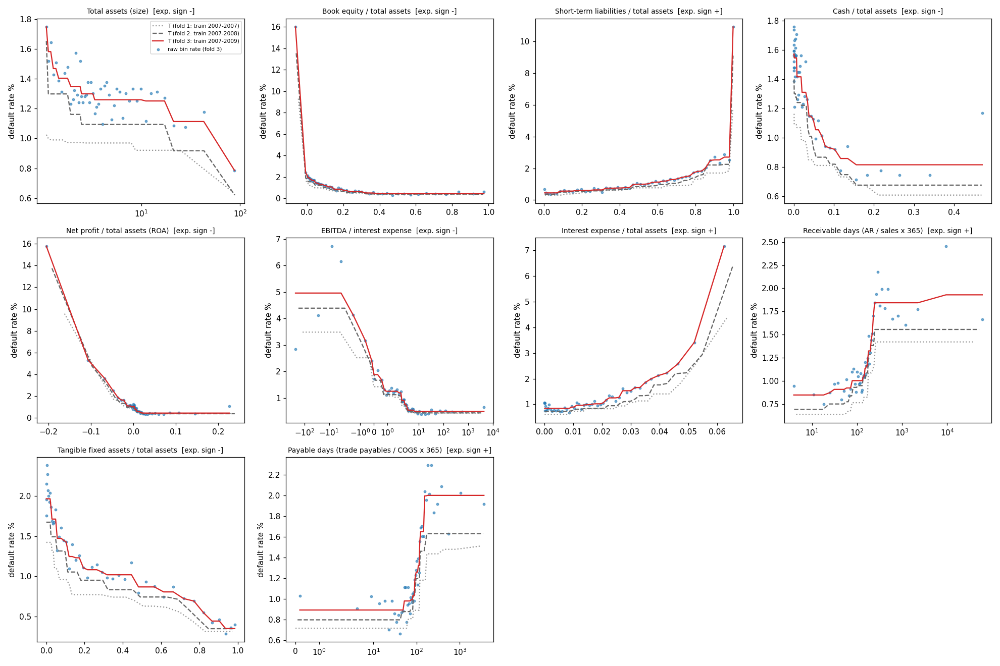
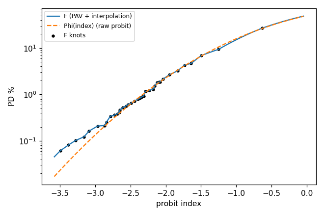

# RC-03 explainability pack (fold 3 model: trained on fs_year 2007-2009)

Generated by `experiments/riskcalc/explain.py` from the frozen params files `RC-03/params_fold{1,2,3}.json` (no refitting). Architecture (R-01 Sec. 3.1 p. 14): PD = F(Phi(sum_i beta_i T_i(x_i) + sum_j gamma_j I_j)). Each T_i is the ratio's training-window default rate by quantile bin (shrunk to the base rate, made monotone in the expected direction); it enters the probit as Phi^-1(T_i).

## 1. Driver curves T_i (ratio -> default rate), all three folds

Solid red = fold-3 transform (used for 2010 predictions); dashed/dotted = folds 2/1 (stability across training windows); dots = raw (shrunk, pre-PAV) bin rates. Curves are flat beyond the outer bin centres, so extreme ratios cannot push the PD further (outlier neutralisation). Natural units on the x-axis.

| driver                                     | feature            | p5 value   |   T at p5 % | median    |   T at median % | p95 value   |   T at p95 % | T min-max %   | missing: n / T %   |
|:-------------------------------------------|:-------------------|:-----------|------------:|:----------|----------------:|:------------|-------------:|:--------------|:-------------------|
| Total assets (size)                        | log_assets         | EUR 1.6MM  |        1.58 | EUR 3.4MM |            1.26 | EUR 27.8MM  |         1.11 | 0.79-1.75     | 0 / 1.30           |
| Book equity / total assets                 | equity_ratio       | 0.3%       |        2.12 | 18.1%     |            0.87 | 83.4%       |         0.45 | 0.45-16.01    | 0 / 1.30           |
| Short-term liabilities / total assets      | st_debt_ratio      | 2.1%       |        0.45 | 48.0%     |            0.99 | 95.2%       |         2.71 | 0.45-10.93    | 4 / 1.27           |
| Cash / total assets                        | cash_ratio         | 0.0%       |        1.57 | 1.3%      |            1.42 | 26.3%       |         0.82 | 0.82-1.57     | 15 / 1.19          |
| Net profit / total assets (ROA)            | roa_net            | -6.7%      |        3.58 | 0.3%      |            0.86 | 10.7%       |         0.45 | 0.45-15.78    | 18 / 1.17          |
| EBITDA / interest expense                  | interest_coverage  | -7.6x      |        4.96 | 2.9x      |            0.76 | 560.3x      |         0.49 | 0.49-4.96     | 321 / 1.90         |
| Interest expense / total assets            | interest_to_assets | 0.0%       |        0.84 | 1.3%      |            0.97 | 4.6%        |         2.57 | 0.84-7.17     | 283 / 1.60         |
| Receivable days (AR / sales x 365)         | ar_days            | 18 days    |        0.85 | 147 days  |            1.09 | 7,861 days  |         1.92 | 0.85-1.93     | 1109 / 5.94        |
| Tangible fixed assets / total assets       | tangible_ratio     | 0.0%       |        1.96 | 14.4%     |            1.24 | 93.7%       |         0.35 | 0.35-1.96     | 101 / 1.18         |
| Payable days (trade payables / COGS x 365) | ap_days            | 4 days     |        0.89 | 83 days   |            1.03 | 541 days    |         2.00 | 0.89-2.00     | 68730 / 1.39       |

## 2. Probit coefficients (fold 3), expected vs actual sign, importance

Expected sign for every T_i is + (T_i is already a PD-scale measure). Industry indicators are relative to manufacturing (ATECO C, the largest training level). Importance = standard deviation of beta_i * Phi^-1(T_i) across training rows (how much the driver moves the probit index across firms).

| term                 | expected sign   |   coef (fold 3) |     SE |        z | actual sign   | agrees   | coef fold 1 / 2   |   importance: SD of contribution (train) |
|:---------------------|:----------------|----------------:|-------:|---------:|:--------------|:---------|:------------------|-----------------------------------------:|
| T_log_assets         | +               |          0.6723 | 0.1417 |   4.7438 | +             | yes      | 0.690 / 0.884     |                                   0.0272 |
| T_equity_ratio       | +               |          0.3910 | 0.0187 |  20.8682 | +             | yes      | 0.416 / 0.369     |                                   0.1049 |
| T_st_debt_ratio      | +               |          0.3080 | 0.0201 |  15.3045 | +             | yes      | 0.334 / 0.316     |                                   0.0784 |
| T_cash_ratio         | +               |          0.3414 | 0.0684 |   4.9883 | +             | yes      | 0.265 / 0.449     |                                   0.0314 |
| T_roa_net            | +               |          0.6423 | 0.0189 |  33.9563 | +             | yes      | 0.683 / 0.655     |                                   0.1820 |
| T_interest_coverage  | +               |          0.2374 | 0.0238 |   9.9709 | +             | yes      | 0.204 / 0.242     |                                   0.0684 |
| T_interest_to_assets | +               |          0.4751 | 0.0251 |  18.9595 | +             | yes      | 0.648 / 0.506     |                                   0.0831 |
| T_ar_days            | +               |          0.3999 | 0.0477 |   8.3921 | +             | yes      | 0.594 / 0.428     |                                   0.0475 |
| T_tangible_ratio     | +               |          0.8005 | 0.0406 |  19.7255 | +             | yes      | 1.085 / 0.913     |                                   0.1494 |
| T_ap_days            | +               |          0.6710 | 0.0495 |  13.5427 | +             | yes      | 0.640 / 0.643     |                                   0.0778 |
| ateco_group=A        | n/a (vs ref. C) |         -0.3107 | 0.0570 |  -5.4527 | -             |          | dropped / -0.273  |                                   0.0380 |
| ateco_group=E        | n/a (vs ref. C) |         -0.1131 | 0.0629 |  -1.7999 | -             |          | dropped / dropped |                                   0.0108 |
| ateco_group=F        | n/a (vs ref. C) |         -0.2148 | 0.0173 | -12.3872 | -             |          | -0.248 / -0.271   |                                   0.0818 |
| ateco_group=G        | n/a (vs ref. C) |         -0.1079 | 0.0166 |  -6.4819 | -             |          | -0.128 / -0.132   |                                   0.0415 |
| ateco_group=H        | n/a (vs ref. C) |         -0.0876 | 0.0353 |  -2.4803 | -             |          | -0.125 / -0.132   |                                   0.0142 |
| ateco_group=I        | n/a (vs ref. C) |         -0.3136 | 0.0435 |  -7.2029 | -             |          | dropped / -0.384  |                                   0.0530 |
| ateco_group=J        | n/a (vs ref. C) |         -0.1148 | 0.0365 |  -3.1449 | -             |          | -0.174 / -0.115   |                                   0.0168 |
| ateco_group=L        | n/a (vs ref. C) |         -0.2871 | 0.0186 | -15.4121 | -             |          | -0.315 / -0.328   |                                   0.1133 |
| ateco_group=M        | n/a (vs ref. C) |         -0.1710 | 0.0284 |  -6.0241 | -             |          | -0.269 / -0.222   |                                   0.0345 |
| ateco_group=N        | n/a (vs ref. C) |         -0.0494 | 0.0375 |  -1.3155 | -             |          | -0.147 / -0.087   |                                   0.0067 |
| ateco_group=R        | n/a (vs ref. C) |         -0.1110 | 0.0592 |  -1.8757 | -             |          | dropped / -0.176  |                                   0.0095 |
| ateco_group=OTHER    | n/a (vs ref. C) |         -0.2592 | 0.0418 |  -6.2020 | -             |          | -0.226 / -0.275   |                                   0.0405 |

Dropped in-window by the sign rule (coef <= 0, most negative z first): {1: ['T_bank_debt_ratio', 'T_neg_equity'], 2: ['T_bank_debt_ratio', 'T_neg_equity'], 3: ['T_bank_debt_ratio', 'T_neg_equity']}. Both dropped terms are explained in `experiments/riskcalc/decisions.md` (D-041).

Driver ranking by importance: Net profit / total assets (ROA), Tangible fixed assets / total assets, Book equity / total assets, Interest expense / total assets, Short-term liabilities / total assets, Payable days (trade payables / COGS x 365), EBITDA / interest expense, Receivable days (AR / sales x 365), Cash / total assets, Total assets (size)

## 3. Final transform F (probit index -> PD)

F has 39 monotone knots fitted on the training window; beyond the outer knots it continues with slope 1 on the probit scale. F corrects the shape of the probit's link in-window; it does NOT move the level to the test year's default rate (that is the calibration-specialist's central-tendency question).

## 4. Reason codes for three 2010 test firms (low / mid / high PD)

For each driver we recompute the PD with that driver's contribution set to the training-median firm's contribution (all else unchanged). The difference is the driver's effect on this firm's PD. Industry is compared with the training-average industry effect. Firms are anonymised by row_id; the realised outcome is not shown.

### Example low-PD firm (row_id 9810804842010, PD 0.17%, percentile 10 of 2010)

- Tangible fixed assets / total assets of 87.9% (typical firm: 14.4%) lowered this firm's PD from 0.35% to 0.17% (-0.18 pp).
- Being in ATECO section group C (rather than the average industry) raised this firm's PD from 0.11% to 0.17% (+0.06 pp).
- Book equity / total assets of 86.5% (typical firm: 18.1%) lowered this firm's PD from 0.21% to 0.17% (-0.04 pp).
- Short-term liabilities / total assets of 1.8% (typical firm: 48.0%) lowered this firm's PD from 0.20% to 0.17% (-0.03 pp).

### Example mid-PD firm (row_id 8848302412010, PD 0.57%, percentile 50 of 2010)

- Being in ATECO section group C (rather than the average industry) raised this firm's PD from 0.37% to 0.57% (+0.20 pp).
- Payable days (trade payables / COGS x 365) of 39 days (typical firm: 83 days) lowered this firm's PD from 0.67% to 0.57% (-0.10 pp).
- Tangible fixed assets / total assets of 30.0% (typical firm: 14.4%) lowered this firm's PD from 0.63% to 0.57% (-0.06 pp).
- Net profit / total assets (ROA) of 0.2% (typical firm: 0.3%) raised this firm's PD from 0.52% to 0.57% (+0.05 pp).

### Example high-PD firm (row_id 23758512072010, PD 12.09%, percentile 99 of 2010)

- Net profit / total assets (ROA) of -15.4% (typical firm: 0.3%) raised this firm's PD from 3.53% to 12.09% (+8.56 pp).
- Interest expense / total assets of 5.1% (typical firm: 1.3%) raised this firm's PD from 8.24% to 12.09% (+3.84 pp).
- EBITDA / interest expense of -1.4x (typical firm: 2.9x) raised this firm's PD from 9.04% to 12.09% (+3.04 pp).
- Tangible fixed assets / total assets of 1.6% (typical firm: 14.4%) raised this firm's PD from 9.20% to 12.09% (+2.89 pp).

Effects are not additive in PD units (F and Phi are non-linear); they are additive on the probit index.

## 5. Reusability / harness readiness checks

- params JSON round trip vs stored OOT predictions (fold 3, 174,512 rows): max |diff| = 0.00e+00
- one-row-at-a-time vs batch on 300 rows: max |diff| = 3.33e-16
- messy input ("NA", "", "n.a.", unseen ATECO, dropped column): PDs = 0.0085, 0.0011, 0.0053, 0.0015, 0.0019 (all in (0,1): True)
- Estimation for the harness: `riskcalc.fit_and_save(train_rows, path)` (RC-03 config = `riskcalc.BEST_CONFIG`); prediction: `riskcalc.predict_riskcalc(df, load_params(path))`.
- Prediction complexity: O(n * (p log K + m)) — n rows, p = 10 transforms with K <= 50 knots (binary search), m = 12 indicator columns, plus one O(log B) lookup in F (B = 39 knots). Memory O(n * (p + m)).
