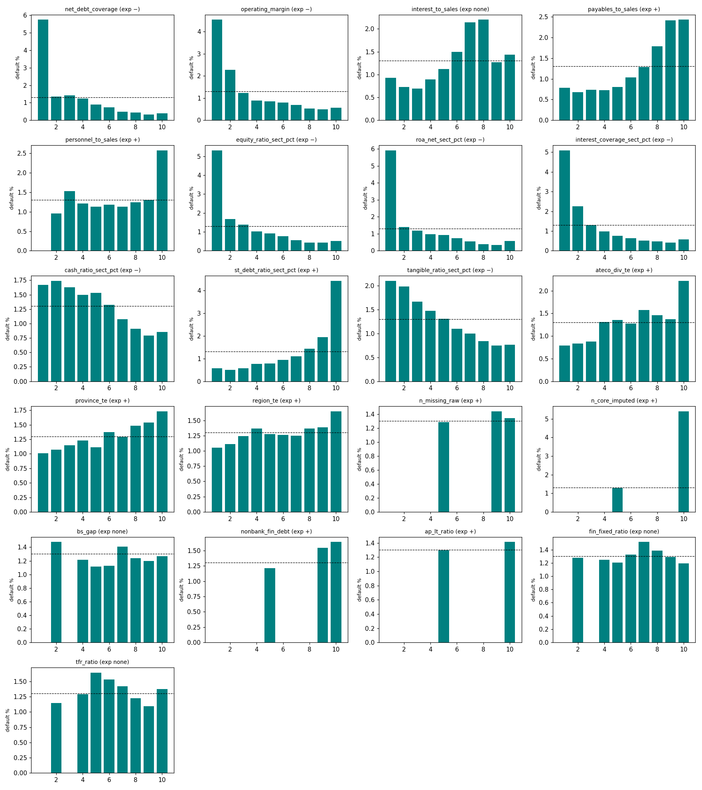

# Round-2 univariate evidence (features-v2)

Generated by `python -m src.features.univariate_v2`. Training rows fs_year 2007-2009, label_status ok: 475,861 rows, 6,195 defaults, base rate 0.0130. The panel is read with a parquet filter fs_year <= 2009 (LOCKBOX: nothing from 2010+ is loaded). Inner check = fit on 2007-08 (305,475 rows), score 2009 (170,386 rows).

AUC < 0.5 means PD falls as the feature rises. Default-rate encodings (`*_te`) on training rows are out-of-fold (5 folds grouped by firm id); the 2009 column uses the 2007-08 full-window table.

## 1. Univariate table

| feature                    | in_full2   | family            | expected   | empirical   |   auc_0709 |   auc_imputed |   auc_inner_2009 |   missing_rate |   max_rho_existing | partner_existing   |   max_rho_new | partner_new                | sign_ok   |
|:---------------------------|:-----------|:------------------|:-----------|:------------|-----------:|--------------:|-----------------:|---------------:|-------------------:|:-------------------|--------------:|:---------------------------|:----------|
| net_debt_coverage          | False      | coverage          | −          | −           |     0.2474 |        0.2475 |           0.2459 |         0.0002 |             0.9902 | cfo_to_debt        |        0.782  | roa_net_sect_pct           | True      |
| operating_margin           | True       | profitability     | −          | −           |     0.2914 |        0.3021 |           0.2944 |         0.0328 |             0.8695 | ebitda_margin      |        0.5596 | roa_net_sect_pct           | True      |
| interest_to_sales          | True       | coverage/activity | none       | +           |     0.5796 |        0.5798 |           0.587  |         0.0029 |             0.6362 | interest_to_assets |        0.5332 | interest_coverage_sect_pct | True      |
| payables_to_sales          | True       | activity          | +          | +           |     0.6361 |        0.6368 |           0.6521 |         0.1393 |             0.928  | ap_days            |        0.2404 | st_debt_ratio_sect_pct     | True      |
| personnel_to_sales         | True       | activity          | +          | +           |     0.5702 |        0.5682 |           0.5616 |         0.0025 |             0.3483 | asset_turnover     |        0.7516 | tfr_ratio                  | True      |
| equity_ratio_sect_pct      | True       | sector-relative   | −          | −           |     0.2618 |        0.2618 |           0.2527 |         0      |             0.9605 | equity_ratio       |        0.5825 | st_debt_ratio_sect_pct     | True      |
| roa_net_sect_pct           | True       | sector-relative   | −          | −           |     0.2524 |        0.2524 |           0.2545 |         0      |             0.9783 | roa_net            |        0.782  | net_debt_coverage          | True      |
| interest_coverage_sect_pct | True       | sector-relative   | −          | −           |     0.2677 |        0.2679 |           0.2675 |         0.0007 |             0.9623 | interest_coverage  |        0.7209 | net_debt_coverage          | True      |
| cash_ratio_sect_pct        | True       | sector-relative   | −          | −           |     0.4256 |        0.4256 |           0.4314 |         0      |             0.9678 | cash_ratio         |        0.3293 | interest_to_sales          | True      |
| st_debt_ratio_sect_pct     | True       | sector-relative   | +          | +           |     0.7026 |        0.7026 |           0.7113 |         0      |             0.911  | st_debt_ratio      |        0.5825 | equity_ratio_sect_pct      | True      |
| tangible_ratio_sect_pct    | True       | sector-relative   | −          | −           |     0.3923 |        0.3923 |           0.3868 |         0.0002 |             0.8816 | tangible_ratio     |        0.3141 | st_debt_ratio_sect_pct     | True      |
| ateco_div_te               | True       | industry          | +          | +           |     0.5797 |        0.5797 |           0.5718 |         0      |             0.4514 | asset_turnover     |        0.4346 | tfr_ratio                  | True      |
| province_te                | True       | geography         | +          | +           |     0.5473 |        0.5473 |           0.537  |         0      |             0.063  | bank_debt_ratio    |        0.4538 | region_te                  | True      |
| region_te                  | True       | geography         | +          | +           |     0.5295 |        0.5295 |           0.5289 |         0      |             0.0256 | equity_ratio       |        0.4538 | province_te                | True      |
| n_missing_raw              | False      | data quality      | +          | none        |     0.5051 |        0.5051 |           0.5034 |         0      |             0.9937 | debt_split_missing |        0.0574 | tfr_ratio                  | True      |
| n_core_imputed             | True       | data quality      | +          | none        |     0.505  |        0.505  |           0.5061 |         0      |             0.2529 | rev_nonpositive    |        0.0478 | net_debt_coverage          | True      |
| bs_gap                     | True       | data quality      | none       | −           |     0.4817 |        0.4817 |           0.4797 |         0.0008 |             0.2192 | asset_turnover     |        0.2831 | tfr_ratio                  | True      |
| nonbank_fin_debt           | True       | leverage          | +          | +           |     0.5234 |        0.5187 |           0.5241 |         0.157  |             0.1026 | interest_to_assets |        0.0844 | equity_ratio_sect_pct      | True      |
| ap_lt_ratio                | True       | leverage          | +          | none        |     0.501  |        0.5009 |           0.5024 |         0.0995 |             0.0832 | st_debt_share      |        0.0381 | st_debt_ratio_sect_pct     | True      |
| fin_fixed_ratio            | True       | asset structure   | none       | none        |     0.5027 |        0.5026 |           0.5044 |         0.0005 |             0.2217 | log_assets         |        0.1218 | tfr_ratio                  | True      |
| tfr_ratio                  | True       | asset structure   | none       | none        |     0.5096 |        0.5095 |           0.5022 |         0.0003 |             0.6836 | asset_turnover     |        0.7516 | personnel_to_sales         | True      |

## 2. Default rate by decile (training 2007-09; ties stay together, so mass points leave empty deciles)

| feature                    | D1     | D2     | D3     | D4     |     D5 | D6     | D7     | D8     | D9     |    D10 |
|:---------------------------|:-------|:-------|:-------|:-------|-------:|:-------|:-------|:-------|:-------|-------:|
| net_debt_coverage          | 0.0575 | 0.0136 | 0.0143 | 0.0123 | 0.0089 | 0.0073 | 0.0049 | 0.0043 | 0.0032 | 0.004  |
| operating_margin           | 0.0453 | 0.0227 | 0.0122 | 0.0089 | 0.0084 | 0.0080 | 0.0069 | 0.0053 | 0.0050 | 0.0055 |
| interest_to_sales          | 0.0093 | 0.0072 | 0.0069 | 0.0089 | 0.0112 | 0.0149 | 0.0214 | 0.0220 | 0.0127 | 0.0143 |
| payables_to_sales          | 0.0079 | 0.0068 | 0.0073 | 0.0073 | 0.0081 | 0.0104 | 0.0129 | 0.0179 | 0.0242 | 0.0243 |
| personnel_to_sales         |        | 0.0096 | 0.0154 | 0.0121 | 0.0114 | 0.0118 | 0.0113 | 0.0124 | 0.0131 | 0.0258 |
| equity_ratio_sect_pct      | 0.0532 | 0.0169 | 0.0138 | 0.0101 | 0.0091 | 0.0078 | 0.0055 | 0.0043 | 0.0043 | 0.0052 |
| roa_net_sect_pct           | 0.0592 | 0.0140 | 0.0119 | 0.0098 | 0.0092 | 0.0073 | 0.0055 | 0.0040 | 0.0034 | 0.0058 |
| interest_coverage_sect_pct | 0.0510 | 0.0225 | 0.0131 | 0.0098 | 0.0076 | 0.0064 | 0.0051 | 0.0048 | 0.0041 | 0.0058 |
| cash_ratio_sect_pct        | 0.0167 | 0.0174 | 0.0163 | 0.0149 | 0.0153 | 0.0133 | 0.0108 | 0.0091 | 0.0079 | 0.0086 |
| st_debt_ratio_sect_pct     | 0.0057 | 0.0051 | 0.0057 | 0.0076 | 0.0078 | 0.0094 | 0.0109 | 0.0143 | 0.0194 | 0.0442 |
| tangible_ratio_sect_pct    | 0.0210 | 0.0198 | 0.0166 | 0.0148 | 0.0131 | 0.0110 | 0.0100 | 0.0084 | 0.0075 | 0.0077 |
| ateco_div_te               | 0.0079 | 0.0083 | 0.0088 | 0.0131 | 0.0136 | 0.0127 | 0.0157 | 0.0146 | 0.0137 | 0.0222 |
| province_te                | 0.0101 | 0.0107 | 0.0115 | 0.0123 | 0.0112 | 0.0138 | 0.0129 | 0.0149 | 0.0154 | 0.0173 |
| region_te                  | 0.0105 | 0.0111 | 0.0124 | 0.0137 | 0.0127 | 0.0126 | 0.0125 | 0.0137 | 0.0139 | 0.0165 |
| n_missing_raw              |        |        |        |        | 0.0129 |        |        |        | 0.0144 | 0.0134 |
| n_core_imputed             |        |        |        |        | 0.0129 |        |        |        |        | 0.054  |
| bs_gap                     |        | 0.0148 |        | 0.0121 | 0.0111 | 0.0113 | 0.0141 | 0.0124 | 0.0120 | 0.0127 |
| nonbank_fin_debt           |        |        |        |        | 0.0121 |        |        |        | 0.0154 | 0.0164 |
| ap_lt_ratio                |        |        |        |        | 0.013  |        |        |        |        | 0.0141 |
| fin_fixed_ratio            |        | 0.0128 |        | 0.0125 | 0.0121 | 0.0132 | 0.0152 | 0.0139 | 0.0129 | 0.0119 |
| tfr_ratio                  |        | 0.0115 |        | 0.0129 | 0.0165 | 0.0153 | 0.0142 | 0.0123 | 0.0109 | 0.0137 |

## 3. Pairs with |Spearman| >= 0.70 involving a new feature

| a                  | b                          |   spearman |
|:-------------------|:---------------------------|-----------:|
| equity_ratio       | equity_ratio_sect_pct      |     0.9605 |
| st_debt_ratio      | st_debt_ratio_sect_pct     |     0.911  |
| cash_ratio         | cash_ratio_sect_pct        |     0.9678 |
| roa_net            | net_debt_coverage          |     0.8067 |
| roa_net            | roa_net_sect_pct           |     0.9783 |
| roa_oper           | roa_net_sect_pct           |     0.7266 |
| ebitda_margin      | operating_margin           |     0.8695 |
| interest_coverage  | net_debt_coverage          |     0.763  |
| interest_coverage  | interest_coverage_sect_pct |     0.9623 |
| cfo_to_debt        | net_debt_coverage          |     0.9902 |
| cfo_to_debt        | roa_net_sect_pct           |     0.7757 |
| cfo_to_debt        | interest_coverage_sect_pct |     0.7162 |
| ap_days            | payables_to_sales          |     0.928  |
| tangible_ratio     | tangible_ratio_sect_pct    |     0.8816 |
| debt_split_missing | n_missing_raw              |     0.9937 |
| net_debt_coverage  | roa_net_sect_pct           |     0.782  |
| net_debt_coverage  | interest_coverage_sect_pct |     0.7209 |
| personnel_to_sales | tfr_ratio                  |     0.7516 |

## 4. VIF (imputed GLM view, all v1 + v2 numeric features; top 20)

| feature                    |   vif |
|:---------------------------|------:|
| st_debt_ratio              | 48.28 |
| tangible_ratio             | 36.63 |
| wc_ratio                   | 35.97 |
| ebitda_margin              | 15.49 |
| operating_margin           | 15.44 |
| equity_ratio               | 13.25 |
| st_debt_ratio_sect_pct     | 11.67 |
| fin_fixed_ratio            |  9.46 |
| equity_ratio_sect_pct      |  8.55 |
| n_missing_raw              |  8.42 |
| debt_split_missing         |  8.36 |
| interest_coverage_sect_pct |  8.13 |
| st_debt_share              |  8    |
| roa_net                    |  7.78 |
| roa_oper                   |  6.56 |
| interest_coverage          |  5.16 |
| net_debt_coverage          |  5.09 |
| payables_to_sales          |  4.84 |
| tangible_ratio_sect_pct    |  4.17 |
| roa_net_sect_pct           |  4.06 |

What we do about it: the full2 set is a **GBM set**; trees do not invert the design, so high VIF is tolerated there (D-025) and explanations are reported by family. No v2 feature enters the probit core; anyone using full2 in a GLM must use ridge / L2 or drop the partner listed in §3.

## 5. Shrunk default-rate encodings

| feature      |   levels |        m |   tau2 |    p0 |   enc_min |   enc_max | m_oof                    |   auc_train_insample |   auc_train_oof |   auc_inner_2009 |
|:-------------|---------:|---------:|-------:|------:|----------:|----------:|:-------------------------|---------------------:|----------------:|-----------------:|
| ateco_div_te |       83 |  554.747 |      0 | 0.013 |   -0.9036 |    0.8912 | 590;535;536;539;566      |               0.5917 |          0.5797 |           0.5718 |
| province_te  |      110 | 1834.18  |      0 | 0.013 |   -0.6429 |    0.5231 | 1744;1998;1743;1939;1889 |               0.5642 |          0.5473 |           0.537  |
| region_te    |       20 | 3878.74  |      0 | 0.013 |   -0.4295 |    0.2367 | 3498;4186;4155;3849;4087 |               0.5356 |          0.5295 |           0.5289 |

## 6. Data checks (hypotheses tested before building features)

| check                                                   | value                  |
|:--------------------------------------------------------|:-----------------------|
| goodwill - ebitda < 0 (share of rows)                   | 0.00011557996978109154 |
| goodwill - ebitda == 0 (share)                          | 0.2616583414064191     |
| of which liab_lt_emp (TFR) > 0                          | 0.009428734349023797   |
| goodwill - ebitda > 0: liab_lt_emp > 0                  | 0.931833971117489      |
| ==0 rows in section L (real estate)                     | 0.5251419530490792     |
| all rows in section L                                   | 0.19287775211668953    |
| Spearman(goodwill - ebitda, liab_lt_emp)                | 0.9282698020806989     |
| median personnel / sales (rev > 0, pc >= 0)             | 0.09342426651712862    |
| gross margin == operating margin (|diff| < 1e-6, share) | 0.9999304704542886     |
| all 5 key amounts multiples of 1000 (share)             | 0.0010570313599979825  |
| default rate if all rounded                             | 0.003976143141153081   |
| n rows / n defaults if all rounded                      | 503 / 2                |
| >= 3 of 5 key amounts multiples of 1000 (share)         | 0.001475220705205932   |
| default rate if >= 3 rounded                            | 0.009971509971509971   |
| n rows / n defaults if >= 3 rounded                     | 702 / 7                |
| base default rate                                       | 0.013018507505342947   |
| net liabilities <= 0 (net-cash firms, share)            | 0.02922702217664402    |
| default rate of net-cash firms                          | 0.007046304285303422   |

## 7. Missing / quality counts: default rate by value

| feature        |   value (8 = 8+) |   rows |   default_rate |
|:---------------|-----------------:|-------:|---------------:|
| n_missing_raw  |                0 | 400892 |         0.0129 |
| n_missing_raw  |                1 |    131 |         0.0153 |
| n_missing_raw  |                2 |     84 |         0.0476 |
| n_missing_raw  |                3 |  36453 |         0.0143 |
| n_missing_raw  |                4 |    109 |         0.0183 |
| n_missing_raw  |                5 |     35 |         0.0857 |
| n_missing_raw  |                6 |  37666 |         0.0133 |
| n_missing_raw  |                7 |     62 |         0.0161 |
| n_missing_raw  |                8 |    429 |         0.0186 |
| n_core_imputed |                0 | 474379 |         0.0129 |
| n_core_imputed |                1 |   1169 |         0.0633 |
| n_core_imputed |                2 |    278 |         0.0216 |
| n_core_imputed |                3 |     15 |         0      |
| n_core_imputed |                4 |     19 |         0      |
| n_core_imputed |                5 |      1 |         0      |

## 8. Inner LightGBM ablation (fit 2007-08, score 2009; monotone constraints from expected signs; fixed settings, no tuning; seed 0 unless stated)

| set                                      |   n_features |   auc_2009 |   logloss_2009 |   d_auc_vs_v1 |   d_ll_vs_v1 |
|:-----------------------------------------|-------------:|-----------:|---------------:|--------------:|-------------:|
| v1 full (26)                             |           26 |    0.83144 |        0.06741 |       0       |      0       |
| v1 + F1 RiskCalc France                  |           31 |    0.83167 |        0.06737 |       0.00024 |     -4e-05   |
| v1 + F2 sector pct                       |           32 |    0.83313 |        0.06719 |       0.00169 |     -0.00022 |
| v1 + F3 default-rate enc                 |           29 |    0.83559 |        0.06701 |       0.00415 |     -0.0004  |
| v1 + F4 data quality                     |           29 |    0.83364 |        0.06711 |       0.00221 |     -0.0003  |
| v1 + F5 unused fields                    |           30 |    0.83672 |        0.06697 |       0.00529 |     -0.00044 |
| all 21 candidates                        |           47 |    0.84212 |        0.06661 |       0.01068 |     -0.0008  |
| full2 (final, 45)                        |           45 |    0.84026 |        0.06673 |       0.00882 |     -0.00069 |
| v1 + F3 with IN-SAMPLE encodings (leaky) |           29 |    0.83304 |        0.06748 |       0.00161 |      7e-05   |
| v1 full (26) seed 1                      |           26 |    0.83072 |        0.06735 |      -0.00072 |     -6e-05   |
| v1 full (26) seed 2                      |           26 |    0.83181 |        0.06729 |       0.00038 |     -0.00012 |
| full2 (final, 45) seed 1                 |           45 |    0.84145 |        0.06665 |       0.01002 |     -0.00077 |
| full2 (final, 45) seed 2                 |           45 |    0.84116 |        0.06656 |       0.00973 |     -0.00085 |

## 9. Seed-noise ablation (3 seeds; run of the 21 candidates, `python -m src.features.ablation_v2`)

In this table `full2` = all 21 candidates with interest_to_sales constrained '+' (run before the two rejections and the sign change in D-092 / D-096). Seed s.d. of AUC is about 0.0005, so single-feature differences below ~0.001 are noise.

| set                             |   n_features |   auc_mean |   auc_sd |   ll_mean |   ll_sd |   d_auc_vs_v1 |   d_ll_vs_v1 |   d_auc_vs_full2 |   d_ll_vs_full2 |
|:--------------------------------|-------------:|-----------:|---------:|----------:|--------:|--------------:|-------------:|-----------------:|----------------:|
| v1 full                         |           26 |    0.83132 |  0.00056 |   0.06735 | 6e-05   |       0       |      0       |         -0.01015 |         0.00063 |
| full2                           |           47 |    0.84147 |  0.0006  |   0.06672 | 4e-05   |       0.01015 |     -0.00063 |          0       |         0       |
| v1 + net_debt_coverage          |           27 |    0.83164 |  0.00075 |   0.06737 | 0.0001  |       0.00031 |      2e-05   |         -0.00983 |         0.00065 |
| v1 + operating_margin           |           27 |    0.83172 |  0.00022 |   0.06739 | 2e-05   |       0.0004  |      3e-05   |         -0.00975 |         0.00066 |
| v1 + interest_to_sales          |           27 |    0.83155 |  0.00055 |   0.06738 | 3e-05   |       0.00023 |      2e-05   |         -0.00992 |         0.00065 |
| v1 + payables_to_sales          |           27 |    0.83103 |  0.00054 |   0.06742 | 1e-05   |      -0.00029 |      7e-05   |         -0.01044 |         0.0007  |
| v1 + personnel_to_sales         |           27 |    0.83143 |  0.00026 |   0.06749 | 3e-05   |       0.0001  |      0.00013 |         -0.01004 |         0.00076 |
| v1 + equity_ratio_sect_pct      |           27 |    0.83215 |  0.00106 |   0.06732 | 9e-05   |       0.00083 |     -3e-05   |         -0.00932 |         0.0006  |
| v1 + roa_net_sect_pct           |           27 |    0.83129 |  0.00054 |   0.06738 | 4e-05   |      -4e-05   |      3e-05   |         -0.01018 |         0.00066 |
| v1 + interest_coverage_sect_pct |           27 |    0.83168 |  0.00031 |   0.06734 | 3e-05   |       0.00035 |     -1e-05   |         -0.00979 |         0.00062 |
| v1 + cash_ratio_sect_pct        |           27 |    0.83135 |  0.0003  |   0.0674  | 5e-05   |       2e-05   |      5e-05   |         -0.01012 |         0.00068 |
| v1 + st_debt_ratio_sect_pct     |           27 |    0.83118 |  0.00074 |   0.06743 | 4e-05   |      -0.00015 |      8e-05   |         -0.01029 |         0.0007  |
| v1 + tangible_ratio_sect_pct    |           27 |    0.83193 |  0.00045 |   0.06739 | 3e-05   |       0.00061 |      4e-05   |         -0.00954 |         0.00067 |
| v1 + ateco_div_te               |           27 |    0.83232 |  9e-05   |   0.06737 | 7e-05   |       0.00099 |      2e-05   |         -0.00915 |         0.00065 |
| v1 + province_te                |           27 |    0.83306 |  0.00037 |   0.06733 | 3e-05   |       0.00174 |     -2e-05   |         -0.00841 |         0.00061 |
| v1 + region_te                  |           27 |    0.83301 |  0.0011  |   0.06726 | 9e-05   |       0.00169 |     -0.0001  |         -0.00846 |         0.00053 |
| v1 + n_missing_raw              |           27 |    0.83125 |  0.00027 |   0.06741 | 1e-05   |      -7e-05   |      6e-05   |         -0.01022 |         0.00068 |
| v1 + n_core_imputed             |           27 |    0.83093 |  0.00027 |   0.06743 | 3e-05   |      -0.00039 |      8e-05   |         -0.01053 |         0.00071 |
| v1 + bs_gap                     |           27 |    0.83311 |  0.00066 |   0.06735 | 3e-05   |       0.00179 |     -0       |         -0.00836 |         0.00063 |
| v1 + nonbank_fin_debt           |           27 |    0.8317  |  0.00048 |   0.06739 | 8e-05   |       0.00037 |      3e-05   |         -0.00977 |         0.00066 |
| v1 + ap_lt_ratio                |           27 |    0.83188 |  0.00048 |   0.06737 | 3e-05   |       0.00056 |      2e-05   |         -0.00958 |         0.00065 |
| v1 + fin_fixed_ratio            |           27 |    0.83275 |  0.00018 |   0.06721 | 7e-05   |       0.00142 |     -0.00014 |         -0.00872 |         0.00049 |
| v1 + tfr_ratio                  |           27 |    0.83387 |  0.00042 |   0.06728 | 5e-05   |       0.00254 |     -7e-05   |         -0.0076  |         0.00056 |
| full2 - sector pct block        |           41 |    0.84055 |  0.00059 |   0.06685 | 3e-05   |       0.00923 |     -0.0005  |         -0.00092 |         0.00013 |
| full2 - net_debt_coverage       |           46 |    0.84084 |  0.00048 |   0.06681 | 4e-05   |       0.00951 |     -0.00054 |         -0.00063 |         9e-05   |
| full2 - n_missing_raw           |           46 |    0.84071 |  0.00033 |   0.06678 | 8e-05   |       0.00938 |     -0.00057 |         -0.00076 |         6e-05   |
| full2 - payables_to_sales       |           46 |    0.84119 |  0.00068 |   0.06676 | 9e-05   |       0.00987 |     -0.00059 |         -0.00028 |         3e-05   |
| full2 - tfr_ratio               |           46 |    0.83814 |  0.00027 |   0.06697 | 2e-05   |       0.00682 |     -0.00039 |         -0.00333 |         0.00024 |
| full2 - personnel_to_sales      |           46 |    0.84034 |  0.00029 |   0.06678 | 7e-05   |       0.00902 |     -0.00057 |         -0.00113 |         6e-05   |
| full2 - province_te             |           46 |    0.8408  |  0.00079 |   0.06668 | 0.00012 |       0.00947 |     -0.00067 |         -0.00067 |        -5e-05   |
| full2 - region_te               |           46 |    0.84097 |  0.0006  |   0.06678 | 5e-05   |       0.00964 |     -0.00057 |         -0.0005  |         6e-05   |
| full2 - n_core_imputed          |           46 |    0.84086 |  0.00058 |   0.06678 | 3e-05   |       0.00954 |     -0.00058 |         -0.00061 |         5e-05   |
