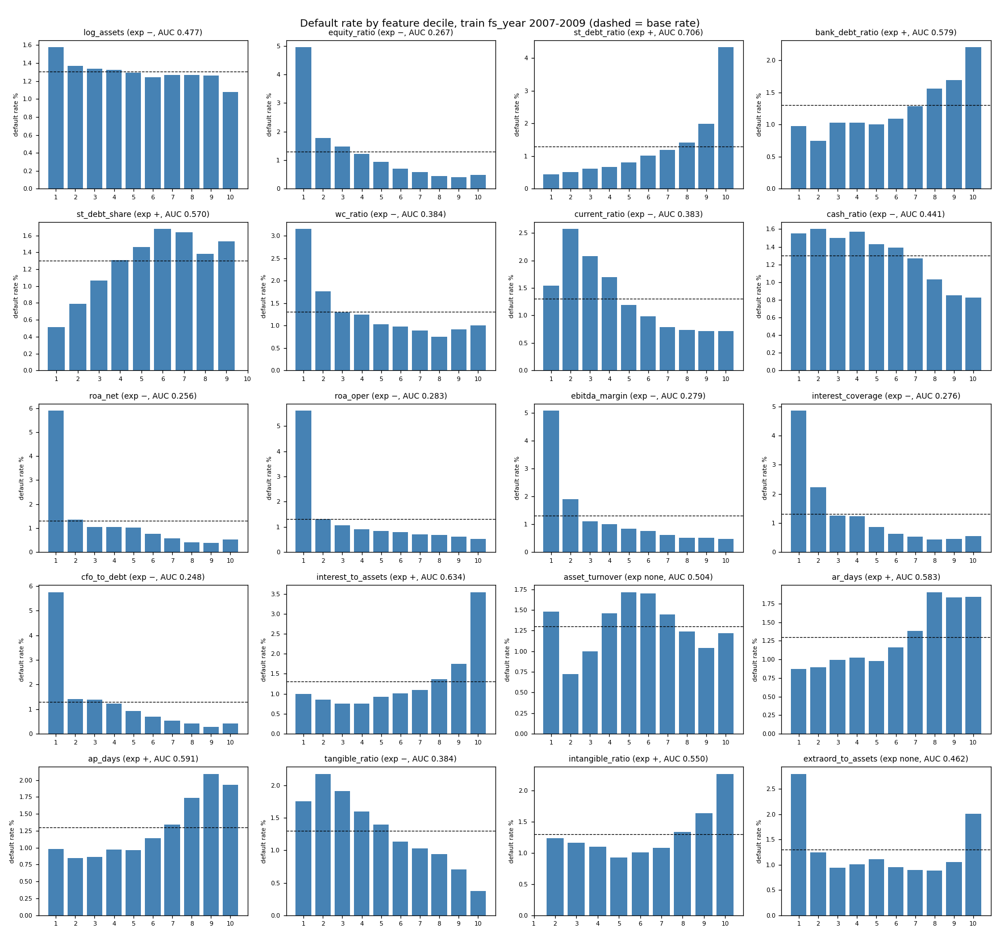

# Feature univariate evidence (train fs_year 2007-2009 only)

Generated by `python -m src.features.univariate` (feature-architect, 2026-10-30). Rows: 475,861 usable training rows of fold 3 (fs_year 2007-2009, primary label), 6,195 defaults, base rate 0.0130. fs_year 2010 (test year of fold 3) is never read. Parameters fitted on the same rows: `params_fold3_example.json` (challengers refit per fold with `build.fit`).

AUC is computed on rows where the feature is defined (`auc`) and after imputation (`auc_imputed`). AUC < 0.5 means PD falls as the feature rises (expected sign −). `empirical` is the sign implied by the AUC (|AUC−0.5| < 0.01 → none). `dr_d1` / `dr_d10` = default rate in the lowest / highest decile.

## 1. Univariate power, direction and missingness

| feature            | family            | expected   |    auc |   auc_imputed |   power | empirical   | agrees   |   missing_rate | dr_missing   |   dr_present | dr_d1   | dr_d10   | winsor_lo   | winsor_hi   | core   |
|:-------------------|:------------------|:-----------|-------:|--------------:|--------:|:------------|:---------|---------------:|:-------------|-------------:|:--------|:---------|:------------|:------------|:-------|
| cfo_to_debt        | coverage          | −          | 0.2476 |        0.2477 |  0.5049 | −           | yes      |         0.0005 | 0.0194       |       0.013  | 0.0575  | 0.0041   | -0.3947     | 2.3716      | False  |
| roa_net            | profitability     | −          | 0.2559 |        0.2559 |  0.4881 | −           | yes      |         0      | 0.0000       |       0.013  | 0.0590  | 0.0053   | -0.2319     | 0.2456      | True   |
| equity_ratio       | leverage          | −          | 0.2672 |        0.2672 |  0.4656 | −           | yes      |         0      |              |       0.013  | 0.0494  | 0.0049   | -0.0809     | 0.9806      | True   |
| interest_coverage  | coverage          | −          | 0.2761 |        0.2762 |  0.4479 | −           | yes      |         0.0007 | 0.0218       |       0.013  | 0.0486  | 0.0056   | -364.2214   | 5782.0345   | True   |
| ebitda_margin      | profitability     | −          | 0.2794 |        0.2912 |  0.4413 | −           | yes      |         0.0329 | 0.0186       |       0.0128 | 0.0508  | 0.0047   | -9.5619     | 0.9169      | False  |
| roa_oper           | profitability     | −          | 0.2827 |        0.2827 |  0.4347 | −           | yes      |         0      | 0.0000       |       0.013  | 0.0561  | 0.0051   | -0.2123     | 0.3171      | False  |
| st_debt_ratio      | leverage          | +          | 0.7056 |        0.7056 |  0.4112 | +           | yes      |         0      | 0.0000       |       0.013  | 0.0045  | 0.0433   | 0.0019      | 1.0008      | True   |
| interest_to_assets | coverage          | +          | 0.6343 |        0.6343 |  0.2687 | +           | yes      |         0.0006 | 0.0177       |       0.013  | 0.0099  | 0.0354   | 0.0000      | 0.0649      | True   |
| neg_equity         | leverage (flag)   | +          | 0.6243 |        0.6243 |  0.2487 | +           | yes      |         0      |              |       0.013  |         |          |             |             | True   |
| current_ratio      | liquidity         | −          | 0.383  |        0.383  |  0.2339 | −           | yes      |         0.0004 | 0.0000       |       0.013  | 0.0154  | 0.0072   | 0.0298      | 109.5834    | False  |
| wc_ratio           | liquidity         | −          | 0.3836 |        0.3836 |  0.2328 | −           | yes      |         0      | 0.0000       |       0.013  | 0.0315  | 0.0100   | -0.8071     | 0.9661      | False  |
| tangible_ratio     | asset structure   | −          | 0.3839 |        0.3839 |  0.2322 | −           | yes      |         0.0002 | 0.0099       |       0.013  | 0.0175  | 0.0037   | 0.0000      | 0.9876      | True   |
| ap_days            | activity          | +          | 0.5905 |        0.5952 |  0.1811 | +           | yes      |         0.1444 | 0.0139       |       0.0129 | 0.0098  | 0.0193   | 0.0000      | 4883.6875   | False  |
| ar_days            | activity          | +          | 0.5833 |        0.5828 |  0.1666 | +           | yes      |         0.0023 | 0.0658       |       0.0129 | 0.0087  | 0.0184   | 2.9647      | 59981.5767  | True   |
| bank_debt_ratio    | leverage          | +          | 0.5787 |        0.5741 |  0.1574 | +           | yes      |         0.1567 | 0.0139       |       0.0129 | 0.0098  | 0.0220   | 0.0000      | 0.9073      | False  |
| st_debt_share      | leverage          | +          | 0.5703 |        0.5703 |  0.1406 | +           | yes      |         0.0007 | 0.0119       |       0.013  | 0.0051  |          | 0.0048      | 1.0000      | False  |
| cash_ratio         | liquidity         | −          | 0.4413 |        0.4413 |  0.1174 | −           | yes      |         0      | 0.0000       |       0.013  | 0.0155  | 0.0083   | 0.0000      | 0.4997      | True   |
| intangible_ratio   | asset structure   | +          | 0.5502 |        0.5501 |  0.1004 | +           | yes      |         0.0003 | 0.0311       |       0.013  |         | 0.0227   | 0.0000      | 0.4504      | False  |
| extraord_to_assets | profitability     | none       | 0.4616 |        0.4616 |  0.0768 | −           | n/a      |         0.0005 | 0.0260       |       0.013  | 0.0280  | 0.0201   | -0.0466     | 0.1092      | False  |
| log_assets         | size              | −          | 0.4765 |        0.4765 |  0.0469 | −           | yes      |         0      |              |       0.013  | 0.0157  | 0.0108   | 14.2343     | 18.4427     | True   |
| rev_nonpositive    | activity (flag)   | none       | 0.5071 |        0.5071 |  0.0142 | none        | n/a      |         0      |              |       0.013  |         |          |             |             | False  |
| debt_split_missing | missing indicator | +          | 0.5052 |        0.5052 |  0.0103 | none        | weak     |         0      |              |       0.013  |         |          |             |             | False  |
| asset_turnover     | activity          | none       | 0.5044 |        0.5044 |  0.0089 | none        | n/a      |         0      | 0.0000       |       0.013  | 0.0148  | 0.0122   | 0.0000      | 3.7689      | False  |

Decile plot: `deciles.png`; decile table: `deciles.csv`.

## 2. Default rate by decile (%)

| feature            | D1   |   D2 |   D3 |   D4 |   D5 |   D6 |   D7 |   D8 |   D9 | D10   |
|:-------------------|:-----|-----:|-----:|-----:|-----:|-----:|-----:|-----:|-----:|:------|
| log_assets         | 1.57 | 1.37 | 1.34 | 1.32 | 1.29 | 1.24 | 1.27 | 1.27 | 1.26 | 1.08  |
| equity_ratio       | 4.94 | 1.77 | 1.48 | 1.23 | 0.95 | 0.71 | 0.59 | 0.44 | 0.41 | 0.49  |
| st_debt_ratio      | 0.45 | 0.52 | 0.62 | 0.67 | 0.8  | 1.02 | 1.2  | 1.41 | 2    | 4.33  |
| bank_debt_ratio    | 0.98 | 0.75 | 1.03 | 1.03 | 1.01 | 1.09 | 1.29 | 1.56 | 1.7  | 2.20  |
| st_debt_share      | 0.51 | 0.79 | 1.06 | 1.31 | 1.46 | 1.68 | 1.64 | 1.38 | 1.53 |       |
| wc_ratio           | 3.15 | 1.76 | 1.3  | 1.24 | 1.03 | 0.97 | 0.89 | 0.75 | 0.92 | 1.00  |
| current_ratio      | 1.54 | 2.57 | 2.08 | 1.69 | 1.19 | 0.98 | 0.79 | 0.74 | 0.72 | 0.72  |
| cash_ratio         | 1.55 | 1.6  | 1.5  | 1.57 | 1.43 | 1.39 | 1.27 | 1.03 | 0.85 | 0.83  |
| roa_net            | 5.90 | 1.35 | 1.05 | 1.04 | 1.03 | 0.77 | 0.58 | 0.4  | 0.38 | 0.53  |
| roa_oper           | 5.61 | 1.31 | 1.07 | 0.9  | 0.83 | 0.8  | 0.71 | 0.67 | 0.62 | 0.51  |
| ebitda_margin      | 5.08 | 1.91 | 1.11 | 1    | 0.85 | 0.76 | 0.61 | 0.52 | 0.52 | 0.47  |
| interest_coverage  | 4.86 | 2.22 | 1.26 | 1.24 | 0.86 | 0.62 | 0.52 | 0.44 | 0.45 | 0.56  |
| cfo_to_debt        | 5.75 | 1.4  | 1.37 | 1.22 | 0.92 | 0.7  | 0.53 | 0.42 | 0.29 | 0.41  |
| interest_to_assets | 0.99 | 0.85 | 0.75 | 0.75 | 0.93 | 1.01 | 1.1  | 1.36 | 1.74 | 3.54  |
| asset_turnover     | 1.48 | 0.72 | 1    | 1.46 | 1.71 | 1.7  | 1.45 | 1.24 | 1.04 | 1.22  |
| ar_days            | 0.87 | 0.9  | 0.99 | 1.03 | 0.98 | 1.16 | 1.39 | 1.9  | 1.83 | 1.84  |
| ap_days            | 0.98 | 0.85 | 0.86 | 0.97 | 0.97 | 1.14 | 1.34 | 1.73 | 2.09 | 1.93  |
| tangible_ratio     | 1.75 | 2.18 | 1.91 | 1.6  | 1.4  | 1.13 | 1.03 | 0.94 | 0.71 | 0.37  |
| intangible_ratio   |      | 1.24 | 1.17 | 1.1  | 0.93 | 1.01 | 1.08 | 1.34 | 1.64 | 2.27  |
| extraord_to_assets | 2.80 | 1.24 | 0.95 | 1.01 | 1.1  | 0.96 | 0.89 | 0.88 | 1.05 | 2.01  |

## 3. Flags

| flag               |   share |   dr_flag1 |   dr_flag0 |   defaults_flag1 |
|:-------------------|--------:|-----------:|-----------:|-----------------:|
| neg_equity         |  0.0378 |     0.0974 |     0.0097 |             1755 |
| debt_split_missing |  0.1567 |     0.0139 |     0.0129 |             1034 |
| rev_nonpositive    |  0.0328 |     0.0186 |     0.0128 |              290 |

## 4. Stability: univariate AUC by training year (Roger M12)

| feature            |      2007 |      2008 |      2009 |
|:-------------------|----------:|----------:|----------:|
| ap_days            |    0.5772 |    0.5813 |    0.6026 |
| ar_days            |    0.5871 |    0.5716 |    0.5854 |
| asset_turnover     |    0.4875 |    0.5341 |    0.5045 |
| bank_debt_ratio    |    0.5702 |    0.5857 |    0.5806 |
| cash_ratio         |    0.4463 |    0.4385 |    0.4465 |
| cfo_to_debt        |    0.2707 |    0.2417 |    0.2453 |
| current_ratio      |    0.3968 |    0.3734 |    0.383  |
| ebitda_margin      |    0.3117 |    0.2636 |    0.2781 |
| equity_ratio       |    0.2919 |    0.2594 |    0.2562 |
| extraord_to_assets |    0.4699 |    0.4586 |    0.4621 |
| intangible_ratio   |    0.5412 |    0.5676 |    0.5449 |
| interest_coverage  |    0.2951 |    0.2708 |    0.274  |
| interest_to_assets |    0.6309 |    0.644  |    0.648  |
| log_assets         |    0.4963 |    0.4645 |    0.4746 |
| n_defaults         | 1379      | 2064      | 2752      |
| roa_net            |    0.2797 |    0.2434 |    0.2594 |
| roa_oper           |    0.3102 |    0.2738 |    0.2848 |
| st_debt_ratio      |    0.6836 |    0.7218 |    0.7127 |
| st_debt_share      |    0.5591 |    0.5826 |    0.5741 |
| tangible_ratio     |    0.3885 |    0.3841 |    0.376  |
| wc_ratio           |    0.4053 |    0.3683 |    0.3838 |

## 5. Categoricals (levels after pooling; reference = largest level)

Pooling rule: >= 30 training defaults per level, learned in `fit` on the training rows; unseen or missing codes → OTHER.

| feature     | level      |   rows |   defaults |   default_rate | reference   |
|:------------|:-----------|-------:|-----------:|---------------:|:------------|
| ateco_group | A          |   7222 |         54 |         0.0075 | False       |
| ateco_group | C          | 120816 |       1940 |         0.0161 | True        |
| ateco_group | E          |   4369 |         48 |         0.011  | False       |
| ateco_group | F          |  83883 |       1083 |         0.0129 | False       |
| ateco_group | G          |  85690 |       1251 |         0.0146 | False       |
| ateco_group | H          |  12930 |        170 |         0.0131 | False       |
| ateco_group | I          |  14032 |         97 |         0.0069 | False       |
| ateco_group | J          |  10420 |        169 |         0.0162 | False       |
| ateco_group | L          |  91783 |        764 |         0.0083 | False       |
| ateco_group | M          |  20244 |        288 |         0.0142 | False       |
| ateco_group | N          |   9000 |        160 |         0.0178 | False       |
| ateco_group | OTHER      |  11932 |        107 |         0.009  | False       |
| ateco_group | R          |   3540 |         64 |         0.0181 | False       |
| legal_group | OTHER      |    122 |          1 |         0.0082 | False       |
| legal_group | SAU        |  12499 |        113 |         0.009  | False       |
| legal_group | SPA        |  52553 |        476 |         0.0091 | False       |
| legal_group | SRL        | 342710 |       4333 |         0.0126 | True        |
| legal_group | SRU        |  67977 |       1272 |         0.0187 | False       |
| macro_area  | Centre     | 102080 |       1453 |         0.0142 | False       |
| macro_area  | Islands    |  23640 |        305 |         0.0129 | False       |
| macro_area  | North-East | 121167 |       1482 |         0.0122 | False       |
| macro_area  | North-West | 168413 |       2155 |         0.0128 | True        |
| macro_area  | OTHER      |    150 |          6 |         0.04   | False       |
| macro_area  | South      |  60411 |        794 |         0.0131 | False       |

Raw levels pooled into OTHER in this window (rows, defaults): `ateco_group`: {'B': (2262, 20), 'D': (3127, 23), 'O': (32, 1), 'P': (627, 8), 'Q': (4116, 26), 'S': (1646, 22), 'U': (122, 7)}; `legal_group`: {'SAA': (117, 1), 'SRS': (5, 0)}; `macro_area`: {'missing': (150, 6)}

## 6. Correlation clusters and VIF (Roger M8)

Spearman |rho| ≥ 0.7 pairs (imputed, winsorised values; full matrix in `correlation_spearman.csv`):

| feature_a         | feature_b     |   spearman |
|:------------------|:--------------|-----------:|
| wc_ratio          | current_ratio |     0.9143 |
| roa_net           | cfo_to_debt   |     0.8004 |
| interest_coverage | cfo_to_debt   |     0.7602 |
| roa_net           | roa_oper      |     0.7567 |

VIF (= diagonal of the inverse Pearson correlation matrix of the winsorised, imputed features). Rule: VIF > 5 inside the core set → drop or replace the feature; in the full (GBM) set high VIF is tolerated because trees and regularised fits do not need invertible designs, but redundancy is reported.

| feature            |   vif_full_set | vif_core_set   |
|:-------------------|---------------:|:---------------|
| ap_days            |         1.2765 |                |
| ar_days            |         2.1886 | 1.1724         |
| asset_turnover     |         1.9531 |                |
| bank_debt_ratio    |         2.0812 |                |
| cash_ratio         |         1.2939 | 1.2260         |
| cfo_to_debt        |         2.2008 |                |
| current_ratio      |         2.9076 |                |
| debt_split_missing |         1.0369 |                |
| ebitda_margin      |         1.5851 |                |
| equity_ratio       |         5.1741 | 1.9807         |
| extraord_to_assets |         1.6327 |                |
| intangible_ratio   |         1.2782 |                |
| interest_coverage  |         2.144  | 1.5775         |
| interest_to_assets |         2.1324 | 1.3474         |
| log_assets         |         1.0587 | 1.0210         |
| neg_equity         |         1.1492 | 1.1189         |
| rev_nonpositive    |         1.7371 |                |
| roa_net            |         6.548  | 1.4807         |
| roa_oper           |         6.2585 |                |
| st_debt_ratio      |        12.4855 | 1.7323         |
| st_debt_share      |         6.5254 |                |
| tangible_ratio     |         4.5931 | 1.3706         |
| wc_ratio           |         5.6849 |                |

## 7. Missing-data treatment evidence for the debt-split block (Roger G2)

Block missing (any of debt_bank_st, debt_bank_lt, AP_st): 74,565 rows (15.67%); default rate 0.0139 missing vs 0.0129 present.

| feature         | treatment                    |   auc_feature_alone | auc_feature_plus_flag   | auc_on_block_missing_rows   |
|:----------------|:-----------------------------|--------------------:|:------------------------|:----------------------------|
| bank_debt_ratio | share_x_total (adopted)      |              0.5741 | 0.5751                  | 0.5534                      |
| bank_debt_ratio | sector_median                |              0.5679 | 0.5708                  | 0.4623                      |
| bank_debt_ratio | NaN rows dropped (tree view) |              0.5787 |                         |                             |
| ap_days         | share_x_total (adopted)      |              0.5952 | 0.5952                  | 0.6116                      |
| ap_days         | sector_median                |              0.5844 | 0.5865                  | 0.5376                      |
| ap_days         | NaN rows dropped (tree view) |              0.5905 |                         |                             |

Raw fields filled by an exact accounting identity in `_reconstruct` (train rows): rev_operating: 86, COGS: 1, cf_operations: 5

## 8. Core set: multivariate sign check (in-sample logit, standardised, train rows)

In-sample AUC of the core logit (diagnostic only, not a tournament result): 0.8017.

| feature            | expected   |   coef_std | multivariate_sign   | agrees   |
|:-------------------|:-----------|-----------:|:--------------------|:---------|
| log_assets         | −          |     0.0131 | +                   | NO       |
| equity_ratio       | −          |    -0.0761 | −                   | yes      |
| st_debt_ratio      | +          |     0.3597 | +                   | yes      |
| cash_ratio         | −          |    -0.0353 | −                   | yes      |
| roa_net            | −          |    -0.5405 | −                   | yes      |
| interest_coverage  | −          |    -0.1605 | −                   | yes      |
| interest_to_assets | +          |     0.2321 | +                   | yes      |
| ar_days            | +          |     0.1367 | +                   | yes      |
| tangible_ratio     | −          |    -0.3204 | −                   | yes      |
| neg_equity         | +          |     0.1593 | +                   | yes      |
