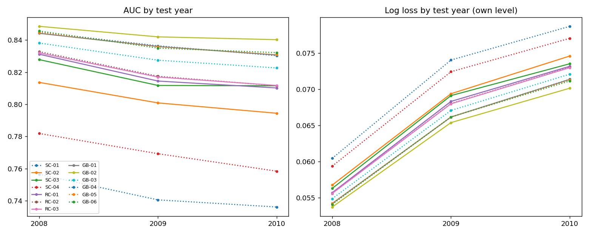
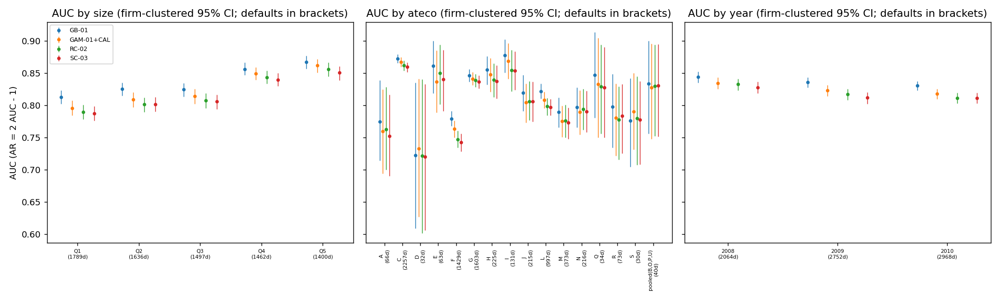
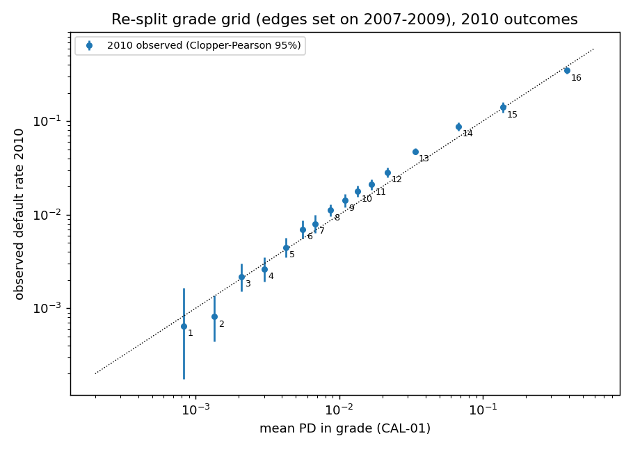

# Team Turquoise: Project Update

**Banca Massiccia: a one-year probability of default for private Italian borrowers**
DS-GA 3001 (Prof. Roger Stein) · Team Turquoise: Kiet Nguyen, Desmond Peng, Chloe Li · 2 November 2026

<!-- Every number below is read from a file under reports/ (path in the hidden comment next to it).
     Decision IDs (D-xxx) point to docs/DECISION_LOG.md; reference IDs (R-xx) to docs/REFERENCES.md,
     and only rows marked VERIFIED there are cited. -->

**Status in five lines.**
(1) The formulation is fixed: one PD per firm-year statement, labelled with a 12-month window that starts 6 months after year-end.
(2) In a walk-forward test on 2008-2010, a gradient-boosted tree model with monotone constraints ranks best (AUC 0.838). It beats a weight-of-evidence scorecard (0.817), a RiskCalc-style probit (0.819) and an explainable additive model (0.825), and every driver moves the PD in the expected direction.
(3) Every model under-predicts the PD level, because the default rate rose each year. One frozen shift of the log-odds fixes most of this, but in 2010 the middle of the book was still under-predicted by about 20-40%.
(4) We have now looked at the test years many times. One sealed year (2011) is planned for the final model choice, but it has already been partly used, and we say so below.
(5) Round 2 (tuning, constraint ablation, recency weights, a random forest, new features) is still running.

---

## 1. Problem and formulation

**One number, two uses.** For each prospective borrower the bank needs the probability that the firm misses a principal or interest payment in the next 12 months (the PD). It may use only what it knows at the decision: the latest annual statement and the firm's industry, legal form and location (assignment, R-30). The PD serves two purposes:

| Use | What it needs from the PD | How we measure it |
|---|---|---|
| Approve or decline (rank applicants against a threshold) | Correct **ordering** | AUC: the chance that a randomly chosen defaulter gets a higher PD than a randomly chosen survivor (0.5 = coin flip). The accuracy ratio, AR = 2·AUC − 1, carries the same information (R-14 eq. 17 p. 12; R-07 p. 83), so we report AUC and note AR. |
| Risk-based pricing | Correct **level** | Log loss (average −log of the probability given to what actually happened; it penalises confident mistakes). Also the observed/predicted ratio (observed default rate ÷ mean PD; 1 = right level) and the calibration slope (1 = PDs spread the right amount). Brier score is reported only as *overall probability accuracy*, not as a calibration measure (R-16 p. 32). |

The threshold use is **our assumption**, taken from the assignment's transaction flow. Stein (2005) treats a cut-off as a coarse special case of pricing and does not recommend it (R-08 pp. 1227, 1233). We estimate only the PD. Loss given default and exposure are not in the data, so expected loss appears only in a stylised pricing illustration (proposal feedback M1).

**Unit of analysis (feedback M2, M5).** One row is one firm's annual statement (a *firm-year*), and the model returns one PD per row. The data contain no loan or application records (D-001). Firms appear in several years. We handle this with a firm-clustered bootstrap (whole firms are resampled, so a firm's rows stay together) and by reporting results separately for firms seen before and for new firms.

**Label and timing (feedback M6).** A statement for fiscal year *t* (every statement date is 31 December) is labelled a default if the firm defaults between 30 June *t*+1 and 30 June *t*+2 (D-002). The reason is legal timing. Accounts must be approved within 120 days of year-end, or 180 days if the statute allows (Civil Code art. 2364, R-28), and filed within 30 days of approval (art. 2435, R-29). So a lender could see the FY *t* statement from about mid-*t*+1. Both articles are verified in their *current* text; the 2007-2012 wording is a secondary source only. Actual filing dates are not in the data, so the 6-month start remains an assumption. It matters: 4,237 rows have a default within 6 months of year-end, before the statement would normally be public. <!-- reports/data/00_labels.md §5 --> We exclude these rows rather than train on them as defaults.

**Information at decision time.** Each PD uses the current row only. We use no default-date features, no later years, no firm history and no external data (D-004, D-020; external data was not cleared, CLAUDE.md §2.6). Growth features would need a frozen lookup of a firm's earlier statements. That was worth about +0.002 AUC for seen firms only, so we dropped it pending Roger/TA's answer (D-020).

## 2. Data and label

<!-- Source: reports/data/01_profile.md §1-2; reports/data/00_labels.md §2, §4 -->
- **Panel:** 1,023,552 statements of 237,711 private Italian firms, fiscal years 2007-2012, with no duplicate firm-year. 12.6% of firms appear once; 101,169 firms appear in all six years.
- **Default rate by fiscal year (primary label):**

| Fiscal year | 2007 | 2008 | 2009 | 2010 | 2011 | 2012 |
|---|---|---|---|---|---|---|
| Usable rows | 144,214 | 161,261 | 170,386 | 174,512 | censored (window 1 month short) | censored |
| Defaults | 1,379 | 2,064 | 2,752 | 2,968 | 2,357 seen in 11 months | – |
| Default rate | 0.96% | 1.28% | 1.62% | 1.70% | 1.28% over 11 months | – |

<!-- reports/data/00_labels.md §2 (primary, start 6); 2011 11-month figures: §5 "Censoring treatments" -->

**Data findings and what we did about them.**

1. **Default dates run to 31 May 2013**, although Appendix B says there is no information after 2012. 1,416 firms have 2013 dates, arriving at a normal monthly pace. We use the dates as given (data end 2013-05-31) and drop them as a sensitivity check. No walk-forward fold changes either way (D-009). <!-- reports/data/00_labels.md §1-2 -->
2. **The label window moves the level by about a third.** Over 2007-2010 the rate is 1.41% with a window starting 6 months after year-end and 1.07% with a window starting at year-end. The question is open with Roger/TA (D-002a). <!-- reports/data/00_labels.md §5 -->
3. **Accounting identities hold and are used to rebuild missing items first** (feedback G2). For example, net working capital = current assets − short-term debt holds exactly on 100% of testable rows, and operating profit = revenue − cost of goods sold on 100%. <!-- reports/data/01_profile.md §5 --> Two fields are not what the dictionary says: `taxes` equals profit before tax on 99.7% of rows, and `goodwill` behaves like value added. Neither is used. <!-- reports/features/rejected_candidates.csv; reports/data/01_profile.md §1 -->
4. **The debt-split block** (bank / other financial / trade debt) is missing as a block. When any short-term component is missing, all three are missing on 98.2% of those rows. The block is more often missing for small firms (13.6% of rows with revenue < €8M vs 1.2% at ≥ €10M) and it persists within firms (57.2% stay missing vs 5.9% that become missing). It doubles in 2008-2010 (16.3% vs 7.3%), which looks like a data-collection effect. It is only weakly informative: default rate 1.57% when missing vs 1.38% when present. <!-- reports/data/02_missingness.md §2-4 --> Abbreviated statements (Civil Code art. 2435-bis, R-27) are a plausible cause, but we have not proven it. Treatment: a "debt split missing" flag, plus each component rebuilt as a training-sector share of the firm's own reported total (D-021).
5. **Blank because of negative equity.** Financing margin is blank on all 40,748 negative-equity rows. The blank is a negative-equity flag, not missing information, so we rebuild the field from equity (D-016). <!-- reports/data/02_missingness.md §4 -->
6. **Categorical codes are labels, never numbers.** We read `HQ_city` (110 codes) as ISTAT province codes and map them to five macro-areas. The code table was checked against ISTAT's official list (R-53). That the data provider used this coding is an inference from the frequency pattern: the five most common codes are Milan, Rome, Brescia, Turin and Naples. `ateco_sector` (83 two-digit divisions) maps to ATECO 2007 sections using the ISTAT volume (R-54 pp. 10, 51-54). Sections and legal forms with fewer than 30 training defaults are pooled into OTHER, and unseen codes also map to OTHER (D-012, D-013, D-023; feedback M7). <!-- reports/data/01_profile.md §1, §3 -->
7. **Selection bias:** we cannot check whether the file holds only firms the bank lent to. We state this as an unverified limitation.

## 3. Features

- **Families and expected signs.** There are 26 inputs: 23 numeric ratios and flags plus 3 categoricals. They come in eight families: size, leverage, liquidity, profitability, debt coverage, activity, asset structure, and missing/abnormal flags. The family structure follows RiskCalc v3.1 (R-01 Sec. 3.1 p. 13), with asset structure added by us. Before any model was fitted, each input was given an expected direction. For example, a higher equity-to-assets ratio should lower the PD, and a higher interest burden should raise it. Three inputs have no expected direction: asset turnover (the data show an inverted U), extraordinary items (two-sided) and zero revenue. Raw euro amounts enter only as ratios (feedback M9). Zero denominators get a documented limit, and ratios are clipped at training-window 1st/99th percentiles (D-018, D-019, D-022; `docs/FEATURE_SPEC.md`).
- **Core and full sets.** The *core* set (10 ratios + 3 categoricals) feeds the linear and probit models. It satisfies |Spearman| < 0.70 and every variance inflation factor (VIF, a collinearity measure) < 5; the largest VIF is 1.98 (equity ratio) (feedback M8, D-025). <!-- reports/features/univariate.md §6 --> These limits fall inside the practice reported for RiskCalc 4.0 France, which treats VIF 4-10 as a warning zone (R-33 Sec. 4.3 p. 18). The *full* set (26) feeds the tree and additive models. The feature set is the same in every fold; only its parameters are refitted (feedback M12).
- **Main rejections** (D-020, D-024; `reports/features/rejected_candidates.csv`):
  - text/sentiment features: the data contain no text (D-003, feedback G3);
  - growth and lag features (see §1);
  - pre-tax return on assets: Spearman 0.96 with net return on assets, a duplicate;
  - the file's return on equity and receivable-days fields: truncated or 72% missing, so we recompute them;
  - value added / assets: cannot be explained under the field's name;
  - long-term debt / assets: no clear expected sign.
- **Caveat (D-062).** The feature set was designed on fiscal years 2007-2009, including scoring on 2009. 2008 and 2009 are later test years, so the 2008-2009 results are mildly optimistic for every model. 2010 is clean. Every promotion must also hold on 2010 alone.

Round-2 features are being tested inside the training windows.

<!-- ROUND 2 RESULTS: to be inserted by orchestrator -->

## 4. Models and preliminary results

**Design of the comparison.** Every model uses the same frozen walk-forward folds. A fold trains on fiscal years ≤ *t* and tests on *t*+1, for test years 2008, 2009 and 2010: 506,159 test rows and 7,784 defaults (D-015). All tuning uses time-ordered inner splits inside the training window (feedback M10, M11). A challenger replaces the incumbent only if all four conditions hold. Statistical ties go to the more transparent model.

1. Its process is clean (no leakage).
2. The firm-clustered paired bootstrap interval favours it on log loss, or on AUC without a worse log loss.
3. It has no more wrong-signed drivers than the incumbent.
4. No test year is clearly worse.

**Table 1. Out-of-time results, pooled 2008-2010** (own level, before the level shift of §5). Intervals are firm-clustered bootstrap 95% intervals.
<!-- Source: reports/tournament/scorecard_r1.md T1 (200 draws) for SC-0x, RC-0x, GB-0x;
     reports/tournament/r1b_diagnostics.md §1.3 (1,000 draws) for GAM-01 and the GB-01 interval in brackets -->

| Model | What it is | AUC [95% CI] | AR | Log loss [95% CI] | Brier | Obs/pred | Wrong-signed drivers |
|---|---|---|---|---|---|---|---|
| **GB-01** | Gradient-boosted trees (LightGBM), monotone constraints, 26 inputs | **0.8375** [0.8321, 0.8408] | 0.675 | **0.06415** [0.06309, 0.06536] | 0.01368 | 1.34 | 0 |
| GAM-01 | Explainable boosting machine (EBM): one readable curve per input, monotone | 0.8254 [0.8202, 0.8300] | 0.651 | 0.06517 | 0.01379 | 1.36 | 0 |
| RC-02 | RiskCalc-style: per-ratio default-rate curves → probit (R-01 Sec. 3.1 p. 14) | 0.8194 [0.8136, 0.8239] | 0.639 | 0.06580 [0.06463, 0.06706] | 0.01393 | 1.36 | 2 |
| SC-03 | Weight-of-evidence (WoE) scorecard, monotone bins (former incumbent) | 0.8166 [0.8115, 0.8208] | 0.633 | 0.06656 [0.06544, 0.06791] | 0.01408 | 1.39 | 0 |
| SC-02 | Logit on the core set | 0.8027 [0.7967, 0.8070] | 0.605 | 0.06716 [0.06602, 0.06839] | 0.01396 | 1.42 | 1 |
| SC-04 | Altman-lineage proxy (4 ratios, re-estimated; not Z′, R-32) | 0.7704 [0.7637, 0.7760] | 0.541 | 0.06986 [0.06878, 0.07114] | 0.01432 | 1.31 | 0 |
| SC-01 | Single best ratio (net return on assets) | 0.7455 [0.7386, 0.7507] | 0.491 | 0.07132 [0.07019, 0.07258] | 0.01449 | 1.27 | 0 |

**Headline against the former incumbent.** GB-01 vs the WoE scorecard: ΔAUC +0.0209 [+0.0188, +0.0231] and Δlog loss −0.00241 [−0.00260, −0.00223]. It is better in each test year and for both seen and new firms. **On the clean 2010 fold alone**, ΔAUC is +0.0191 [+0.0156, +0.0234]. <!-- reports/tournament/scorecard_r1.md T4, T5 --> GB-01 by year: AUC 0.8441 / 0.8359 / 0.8307 (2008 / 2009 / 2010). <!-- scorecard_r1.md T2 --> Against the best transparent model, the EBM, GB-01 is better by ΔAUC +0.0120 [+0.0102, +0.0139] (sign reversed from the file's GAM − GB) and is better in every year and firm group. <!-- reports/tournament/r1b_diagnostics.md §1.4 --> GB-01's per-firm explanations are TreeSHAP contributions (R-41; Shapley theory R-23), reported by family because correlated ratios split the credit between them (D-058).

**What did not work (and the evidence).**
- **Unconstrained boosting (GB-02).** It ranks better, ΔAUC +0.0065 [+0.0052, +0.0079] vs GB-01, but it uses ratios against their economic direction. 83% of the PD movement in working capital / assets and 57% in interest coverage goes against the expected sign. Rejected: a model in which more working capital raises the PD cannot be defended to a credit officer (D-051). <!-- scorecard_r1.md T6, T9 -->
- **Constraints dropped on three features (GB-06):** gains only +0.0005 AUC and the current ratio turns against its sign (87%). Rejected. <!-- scorecard_r1.md T6, T9 -->
- **RiskCalc-style probit:** RC-01 and RC-02 carry wrong-signed curves (negative-equity flag; bank debt). RC-03 drops them with a rule that was added *after* seeing outer results, so we report RC-03 as post hoc, not as evidence (D-063). The probit trails GB-01 by ΔAUC 0.0183 [0.0163, 0.0203] (vs RC-03). <!-- scorecard_r1.md T6, §6 -->
- **EBM with ten pairwise terms (GAM-02):** +0.0008 AUC [+0.0004, +0.0012] over GAM-01. That is detectable but not worth ten more heat maps for officers to read (D-083). <!-- r1b_diagnostics.md §1.4 -->
- **Ensembles (D-086).** A 50/50 log-odds average of GB-01 and the EBM gives AUC 0.8343 vs 0.8375, ΔAUC −0.0032 [−0.0042, −0.0024]. A 70/30 average gives −0.0012 [−0.0017, −0.0007], and adding the probit gives 0.8322. Each is worse in 2010 as well. <!-- experiments/ensemble/ens01_output.txt (100 draws) --> The EBM uses the same information under a restriction, so averaging only dilutes GB-01. R-10 (Sec. 4.4 p. 22) found that simple averaging did not add stable power either.
- **Scorecard benchmarks:** SC-01, SC-02 and SC-04 are worse than SC-03 on both metrics. SC-02's size coefficient is positive in two folds (not significant) (D-032).
- **Ties settled for simplicity:** median imputation for the trees (GB-04) and LightGBM's "advanced" monotone method (GB-05) were statistical ties with GB-01, so we kept the simpler GB-01 (D-056, D-057).

<!-- ROUND 2 RESULTS: to be inserted by orchestrator -->

## 5. Validation

**5.1 Walk-forward design.** We fit up to year *t*, score *t*+1 and roll forward, pooling the out-of-time predictions. This is the out-of-sample, out-of-time procedure of R-07 (Sec. 3, pp. 91-96) and R-01 (Sec. 4.2-4.3). Fold 1 has only one training year (2007). The fiscal-2011 window is one month short, so there are only three folds.

**5.2 Paired, firm-clustered bootstrap.** Each draw resamples whole firms and recomputes both models' metrics on the same draw. The interval is for the *difference* between the two models. The round-1 scorecard used 200 draws; the round-1b diagnostics used 1,000 draws. Our fast weighted estimator matches the shared function to about 1e-16 (`reports/tournament/r1b_diagnostics.md` A1). Metric noise is driven by the number of defaults, not rows (R-07 Sec. 4, pp. 96-99), so every table below shows default counts.

**5.3 Power by segment** (in the style of R-33 Tables 9-14). <!-- reports/tournament/r1b_diagnostics.md §2.1-2.4 -->

| Segment (defaults) | GB-01 AR | EBM (GAM-01+CAL) AR | GB-01 − EBM AUC [95% CI] |
|---|---|---|---|
| Smallest asset quintile, Q1 (1,789) | 0.626 | 0.591 | +0.017 [+0.013, +0.021] |
| Largest asset quintile, Q5 (1,400) | 0.735 | 0.724 | +0.006 [+0.002, +0.009] |
| Manufacturing C (2,257) | 0.745 | 0.735 | +0.005 [+0.003, +0.007] |
| Construction F (1,429) | 0.559 | 0.526 | +0.016 [+0.011, +0.021] |
| Real estate L (997) | 0.643 | 0.617 | +0.013 [+0.008, +0.018] |
| Seen firms (6,862) | 0.688 | 0.664 | +0.012 [+0.010, +0.014] |
| New firms (922) | 0.573 | 0.548 | +0.012 [+0.006, +0.018] |

GB-01 is the best model, or statistically tied, in every cell. Power rises with firm size and is weakest in construction, agriculture and professional services, and for new firms. Sections D, Q and S and the pooled B/O/P/U cell have only 30-40 test defaults each. Their single-model AUC intervals are 0.13-0.23 wide, so we do not rank models there. <!-- r1b_diagnostics.md §2.3 --> RiskCalc 4.0 France advises against scoring single-project real-estate developers (R-33 fn. 14 p. 22); we cannot identify them in the data.

**5.4 Calibration (level).** <!-- Sources: reports/tournament/r1b_diagnostics.md §1.3, §2.5, §4; reports/calibration/final_level_candidates.csv, floor_cap_effect.csv, asymmetry_gb01.csv, auc_invariance_check.csv, q5_label_window_levels.csv -->
- **The problem.** At its own level GB-01 under-predicts: observed/predicted is 1.21 / 1.36 / 1.43 in 2008 / 2009 / 2010. The calibration slope is 0.957-1.005, so the spread of PDs is right and the *level* is wrong. Each training window's default rate trails the next year's rate.
- **The method: prior shift.** We add one constant to every firm's log-odds: logit(PD′) = logit(PD) + logit(τ) − logit(training default rate). This is the prior correction of Saerens et al. (R-22 eq. 4, pp. 5-6), which R-07 (pp. 88-89) calls a simple prior adjustment. A monotone recalibration cannot add power (R-07 pp. 89-91), and on our data within-year AUC is unchanged to machine precision. <!-- auc_invariance_check.csv --> R-22 assumes the profile of defaulters' ratios does not change, which is doubtful over 2008-2012. We use the method as a level tool and do not claim the assumption holds.
- **Choice of target τ.** We compared seven central-tendency rules in the walk-forward. Rule "e" anchors on the annualised default speed of the last training cohort's final six months; it is the latest information a bank would legally have. With it, log loss falls from 0.06415 to 0.06352 and observed/predicted becomes 1.02 / 1.05 / 1.18 (CAL-01). Rule e was chosen *after* seeing 2008-2010, so this gain is optimistic (D-071). For the holdout we ship **τ = 1.49%**. That is the fiscal-2011 anchor of 1.43%, adjusted under an *assumed* random walk of the default rate over two years (D-073). The pooled 2007-2010 average is 1.41%. <!-- final_level_candidates.csv --> If the window started at year-end, τ would be 1.37% (D-076). <!-- q5_label_window_levels.csv --> Under-prediction is the costlier error: a level 30% too low adds 8.2-10.9e-4 to log loss, against 5.6-7.4e-4 for 30% too high (2008-2010). <!-- asymmetry_gb01.csv, k = 0.7 vs 1.3 --> Our pricing reading of that asymmetry is an assumption.
- **Floor and cap.** PDs are clipped to [0.03%, 99%]. The 31 walk-forward PDs below the floor had 0 defaults. A 50% cap was rejected: the 855 PDs above 50% had 553 defaults, and capping raised log loss from 0.063524 to 0.063621. <!-- floor_cap_effect.csv --> The 0.03% floor borrows the Basel II corporate floor by analogy (R-15 para. 285). We do not assume the bank is an IRB bank (one that uses the Basel internal-ratings approach).
- **Grade table on a 16-grade scale.** Grade edges were set on 2007-2009 in-sample PDs and split until no grade held more than 12% of firms, the design target of R-33 (Sec. 4.9 p. 24). The largest grade share is 10.0% in 2010, and observed default rates rise across all 16 grades (D-115). <!-- r1b_diagnostics.md §4 -->
- **2010 under-prediction in the middle of the book.** With the level logic we would ship (CAL-01), 2010 had 2,968 defaults against 2,511.4 expected (observed/predicted 1.18, +457).
  - Grades 1-5 (PD < 0.5%, 42.5% of firms): on target, 174 vs 186.1.
  - Grades 6 and 8-14 (PD 0.5-10%, half the firms): above their acceptance bands, observed/predicted 1.26-1.41, +501.6 defaults.
  - Top grade (PD ≥ 20%): over-predicted, 451 vs 498.9.

  In plain terms, in a 2010-like year mid-grade loans would have been priced 20-40% below their risk. The bands assume independent defaults and therefore understate the uncertainty (R-16 pp. 33-34), so we read the flags as diagnostic. <!-- r1b_diagnostics.md §4.1 and summary -->

**5.5 Overfitting evidence.** <!-- reports/tournament/r1b_diagnostics.md §5.1-5.4 -->

| Check | Evidence | Reading |
|---|---|---|
| Out-of-time calibration slope (1 = right spread) | GB-01 0.976 pooled, 0.957-1.005 by year. New firms 0.83-0.89 for every model (GB-01 0.883). | No over-spread PDs for the population. New firms' PDs are too spread for all models. |
| Same year, in-sample vs out-of-time AUC | GB-01 +0.015 to +0.026 (2.9-5.2 AR points); RC-02 +0.004 to +0.006; GAM-01 +0.006 | The trees fit their training years much harder than the transparent models. R-33 reports an in- vs out-of-sample one-year AR gap of −0.5 points for RiskCalc 4.0 France (Sec. 4.7-4.8 pp. 22-23). We quote only out-of-time numbers. |
| Year-to-year stability | GB-01 AUC range across years 0.0135, the smallest of all models; pooled AUC interval width 0.009 | Gentle decline with the cycle, the same for every model |
| Selection ledger | 30 out-of-time prediction files and 62 calibration configurations scored on 2008-2010, about 90 looks; plus the D-062 feature design and RC-03's post-hoc rule | The winning absolute numbers carry an unquantified selection optimism. GB-01's margins (0.012-0.021 AUC, intervals far from 0) are large relative to it. |
| Fiscal 2011 as a sealed "lockbox" year | **Partly spent.** GB-01 and RC-02 fold-4 models were already scored on 2011 in the calibration round, and τ is anchored to the 2011 rate (correction to D-087: D-118). The EBM and the scorecard have never been scored on 2011. | Plan (D-119, OPEN, needs team sign-off): freeze GB-01 and GAM-01, score both once on 2011 with the 11-month label, report the result whatever it says, and use it **only** to choose between them. 2011 cannot test the level. Then refit on 2007-2011 (D-077). |

<!-- ROUND 2 RESULTS: to be inserted by orchestrator -->

## 6. Hypotheses and status

| Hypothesis | Status | Evidence |
|---|---|---|
| H1. Financial-statement information carries most of the ranking signal; industry and region add little (as R-10 Sec. 4.1 p. 21 found for North American middle-market firms) | **Supported, indirect.** We have no market or macro data, so we cannot test systematic information directly. | A model using only the statement plus three categorical labels gives AUC 0.831-0.844 in every year, including the 2009 recession year (Table 1). GB-01's top drivers are ratios; industry ranks seventh by mean absolute SHAP contribution (0.12 vs 0.41 for the tangible-asset share; D-058, from `experiments/gbm/GB-01/explain.md`). In the probit, industry indicators did not add power on an inner split (D-045). |
| H2. Monotone boosting beats transparent models, at a measurable cost in readability | **Supported.** The cost is about 0.012 AUC vs the EBM and 0.018 vs the probit. Face validity itself costs 0.0065 AUC (GB-02). | `r1b_diagnostics.md` §1.4; `scorecard_r1.md` T6 |
| H3. New firms are harder to rank | **Supported.** This is a population property, not a model property. | GB-01 seen − new AUC 0.0573 [0.0448, 0.0727]; GB-01, the EBM, the probit and the WoE scorecard all show a 0.057-0.061 gap; new-firm slope 0.88 (`scorecard_r1.md` T3; `r1b_diagnostics.md` §5.3) |
| H4. The cycle moves the level, not the ranking | **Mostly supported.** Observed/predicted climbs 1.21 → 1.43 while slopes stay near 1 and the level shift leaves within-year AUC unchanged. Ranking does erode slightly: GB-01 AUC falls by about 0.013 from 2008 to 2010. | `scorecard_r1.md` T2; `r1b_diagnostics.md` §5.3 |
| H5. Average-value imputation biases PDs down (Moody's states this for its earlier versions, R-34) | **Supported only for models that fill with an average.** Relative observed/predicted on the 1,800 rows with a core ratio missing after the rebuild: EBM 1.21 [1.00, 1.46], WoE scorecard 1.30 [1.07, 1.56]. GB-01, which keeps missing values as their own branch, 1.01 [0.84, 1.22]. The probit prices missingness explicitly and over-predicts these rows (0.75). | `r1b_diagnostics.md` §3 |

## 7. Issues and open questions

1. **Label window and data end.** The 6-month start (D-002a) and the use of 2013 default dates (D-009) are our choices pending Roger/TA. They move the level (τ 1.49% vs 1.37%), not the ranking. The shared label function also mislabels incomplete windows (D-011/D-068): it marks the 2,357 fiscal-2011 defaults as complete. A fix is proposed, and until then we build labels from the panel.
2. **Open questions for Roger/TA** (`docs/EMAIL_DRAFT_roger_ta.md`): label window, 2013 dates, the holdout period (which sets the horizon of the τ hedge), whether training-data firm history may be used, and external macro data. Each question states the assumption we use if there is no answer.
3. **Lockbox partly spent** (§5.5). The 2011 check can settle one ranking choice. Nothing in the data can now give an untouched test of the level rule.
4. **Tangible-asset share is GB-01's top driver, but the mechanism is unsourced for PD.** In our data a higher tangible share goes with lower default rates *within every industry* with ≥ 30 defaults (within-industry AUC 0.56-0.73). <!-- reports/tournament/scorecard_r1.md T16 --> The verified source (Almeida & Campello, R-48 Sec. 1 p. 1) supports a creditor-recovery and borrowing-capacity mechanism in US public firms, not a lower PD. We found no study for Italian private firms (REFERENCES Contradiction 11). We present it as our empirical finding.
5. **The level comes from the sample only.** RiskCalc 4.0 France sets its central default tendency from external provisioning and default statistics and deliberately above the sample rate, because development samples miss defaults (R-33 Sec. 2.4 p. 9). We cannot use external data, so our τ may be low if this sample also misses defaults. A holdout year more stressed than 2010 would be under-predicted.
6. **Thin cells.** Several ATECO sections have 30-66 test defaults, so segment calibration there is noise (for example, section S observed/predicted 1.79 on 30 defaults). We do not correct groups using test years (D-078).
7. **New firms' PDs are too spread** (slope 0.88). This needs a shape fix fitted in-window, not a level fix.
8. **EBM fallback needs repair before any use.** Its missing bins are reset to the average firm, which under-prices those rows by about 20% (D-114). A zero-revenue flag *lowers* its score, which an officer will not accept without explanation (D-111).
9. **Human verification is behind** (see §9).

## 8. Next steps to 16 November

1. **Round 2 (running):**
   - GB-07 overfitting diagnostics;
   - GB-08 constraint ablation;
   - GB-09 inner-split tuning;
   - GB-10 recency weights;
   - GB-11 random forest benchmark (as R-17's conclusions recommend, p. 25);
   - new features.

   Results are judged by the same rule, on 2010 as well as pooled, and added to the selection ledger.
2. **Final model choice:** team sign-off on the lockbox protocol (D-119), then one scoring of GB-01 vs GAM-01 on fiscal 2011.
3. **Final fit** on 2007-2011 with the 11-month 2011 label (D-077). Recompute the level shift for the fitted rows and freeze every parameter: clip bounds, category maps, trees, calibrator, shift, floor and cap.
4. **Harness and stress tests.** The prediction function must return one PD in (0,1) per row, in input order, with no re-estimation and no use of other holdout rows. Stress tests cover NAs, blanks, odd codes, unseen categories, both column spellings and single-row input. On complexity: GB-01 scoring is linear in rows, O(n × (F + T × D)) for F inputs and T trees of depth D, measured at about 1 second per 100,000 rows on a laptop (D-059).
5. **Deck** (15-25 slides): reason codes for three example borrowers, driver curves, grade table, limitations, what did not work, contributions appendix, AI-use statement, bibliography. Then a red-team review and a claim audit against REFERENCES.md.

## 9. AI-use statement

We used Anthropic's Claude (Claude Code) as an orchestrated set of agents. They audited the data, verified literature, wrote feature, model and calibration code, acted as the referee, and drafted documents, including this update, which an AI agent drafted from our logged files. The model itself contains no language model. Every number in this update is printed by code in the repository and traced to a file. Citations are restricted to sources an agent located and read, with the page checked (`docs/REFERENCES.md`, status VERIFIED). Unread sources are named as unread. The AI also caught errors in its own work, for example the 2011 lockbox correction (D-118) and a bug in the RiskCalc-style code, fixed before any result was recorded. **Honest status:** most AI-produced artefacts in `docs/AI_USE_LOG.md` are still marked "pending human verification". The team has reviewed the schedule and scope decisions (D-007, D-008, D-017). Before 16 November we will re-run the referee and calibration scripts, spot-check the cited pages, and initial each check in the log.

## References (verified sources only)

- R-01 Dwyer, D. W., Kocagil, A. E., & Stein, R. M. (2004). *Moody's KMV RiskCalc v3.1 Model.* Moody's KMV.
- R-07 Stein, R. M. (2007). Benchmarking default prediction models: Pitfalls and remedies in model validation. *Journal of Risk Model Validation*, 1(1), 77-113.
- R-08 Stein, R. M. (2005). The relationship between default prediction and lending profits. *Journal of Banking & Finance*, 29(5), 1213-1236.
- R-10 Stein, R. M., Kocagil, A. E., Bohn, J., & Akhavein, J. (2003). *Systematic and Idiosyncratic Risk in Middle-Market Default Prediction.* Moody's Special Comment.
- R-14 Engelmann, B., Hayden, E., & Tasche, D. (2003). *Measuring the Discriminative Power of Rating Systems.* Deutsche Bundesbank DP Series 2, No. 01/2003.
- R-15 Basel Committee on Banking Supervision (2006). *International Convergence of Capital Measurement and Capital Standards: A Revised Framework, Comprehensive Version.* BIS.
- R-16 BCBS (2005). *Studies on the Validation of Internal Rating Systems.* Working Paper No. 14 (revised).
- R-17 Lessmann, S., Baesens, B., Seow, H.-V., & Thomas, L. C. (2015). Benchmarking state-of-the-art classification algorithms for credit scoring: An update of research. *EJOR*, 247(1), 124-136 (manuscript version read).
- R-22 Saerens, M., Latinne, P., & Decaestecker, C. (2002). Adjusting the outputs of a classifier to new a priori probabilities. *Neural Computation*, 14(1), 21-41.
- R-23 Lundberg, S. M., & Lee, S.-I. (2017). A unified approach to interpreting model predictions. *NIPS 2017*.
- R-27, R-28, R-29 Italian Civil Code, arts. 2435-bis, 2364 co. 2, 2435 co. 1 (current text).
- R-30 Term Project Instructions, DS-GA 3001, 11 Oct 2026.
- R-32 Altman, E. I. (2000). *Predicting Financial Distress of Companies: Revisiting the Z-Score and ZETA Models.* NYU Stern working paper.
- R-33 Buitrago, M. A., Makarov, U., Zhao, J. Y., & Dwyer, D. (2015). *RiskCalc 4.0 France.* Moody's Analytics.
- R-34 Moody's (2021, 2 Dec). *Advances in default detection and early warning.* Web article.
- R-41 Lundberg, S. M., et al. (2020). From local explanations to global understanding with explainable AI for trees. *Nature Machine Intelligence*, 2(1), 56-67 (preprint text read).
- R-48 Almeida, H., & Campello, M. (2007). Financial constraints, asset tangibility, and corporate investment. *Review of Financial Studies*, 20(5), 1429-1460 (NBER WP 12087 read).
- R-53 ISTAT. *Elenco dei comuni italiani* (code list incl. 110-province coding 2010-2016).
- R-54 ISTAT (2009). *Classificazione delle attività economiche Ateco 2007.* Metodi e Norme n. 40.
