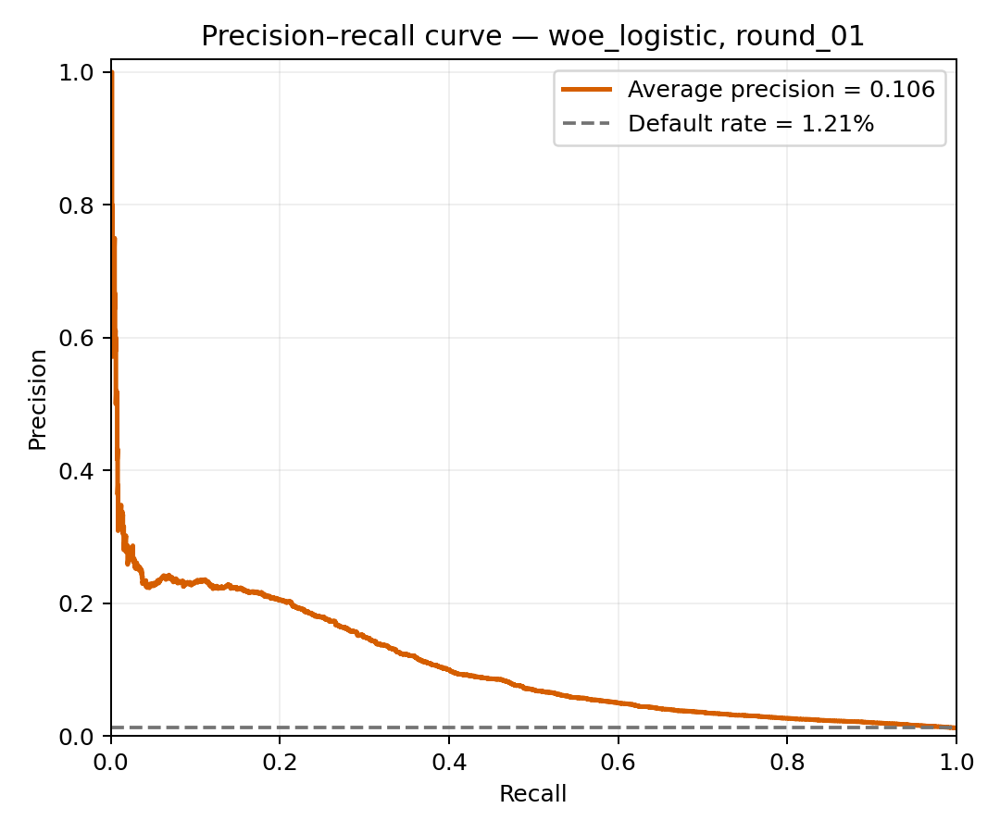
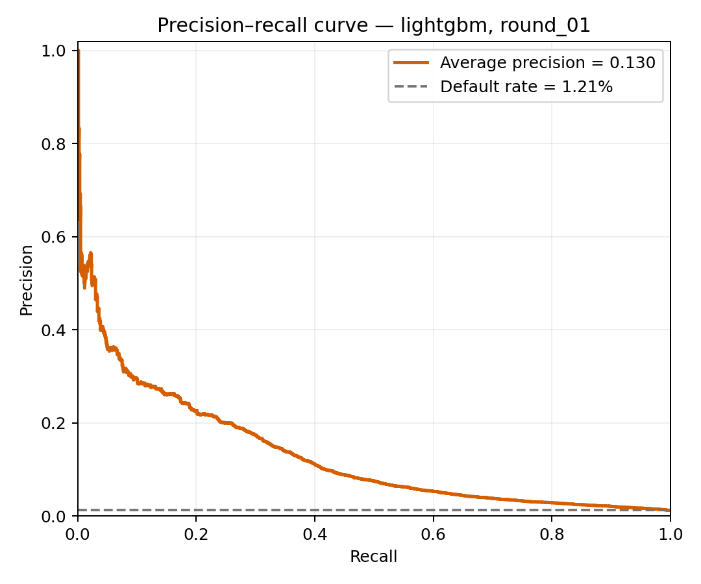
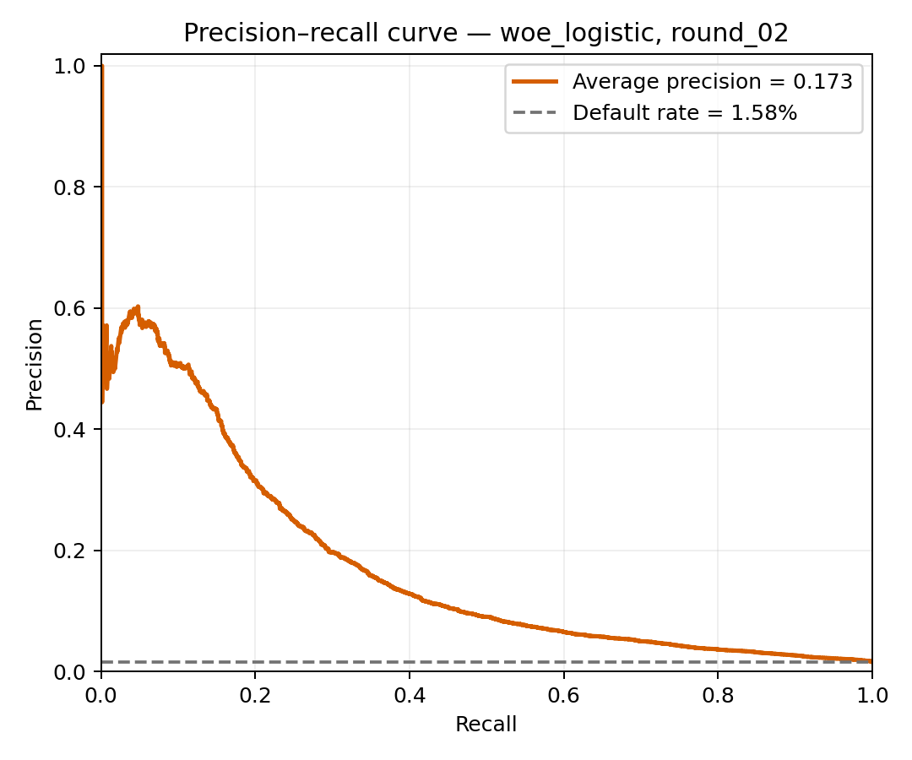
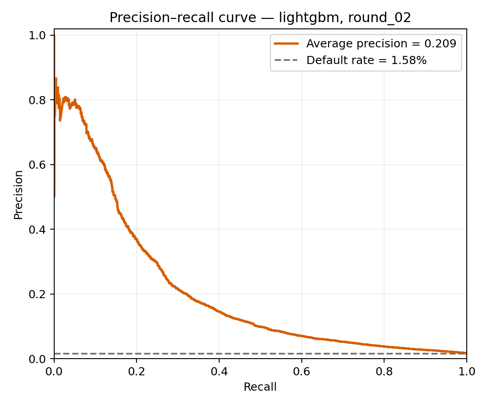
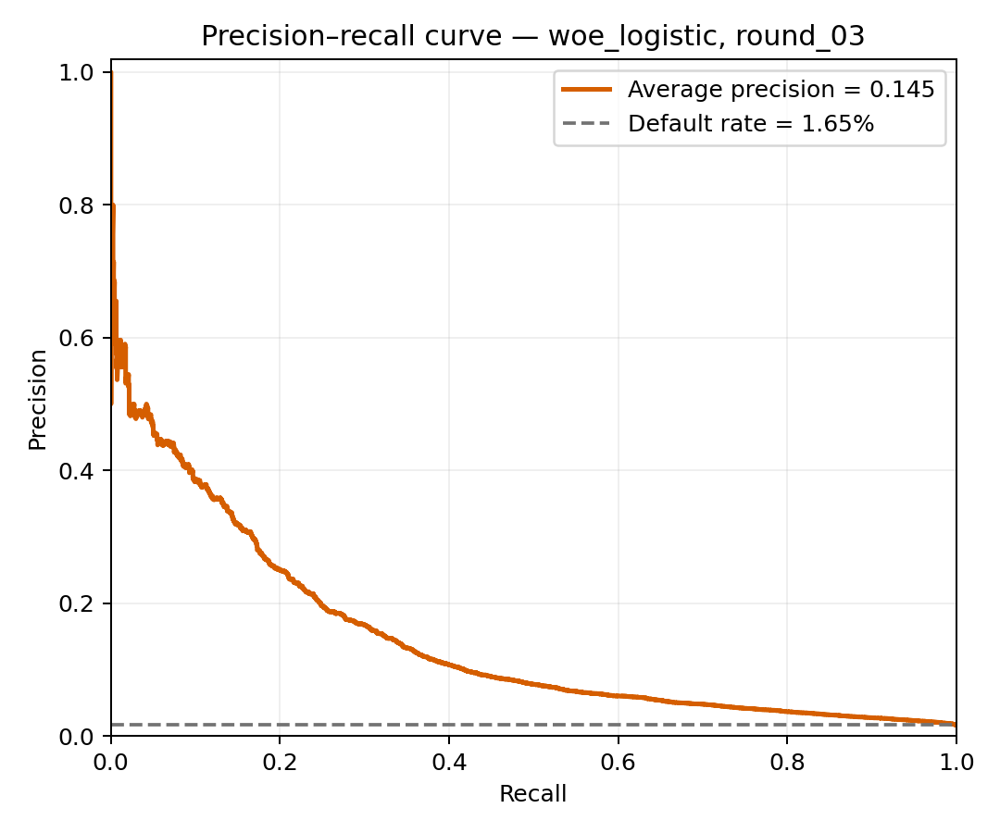
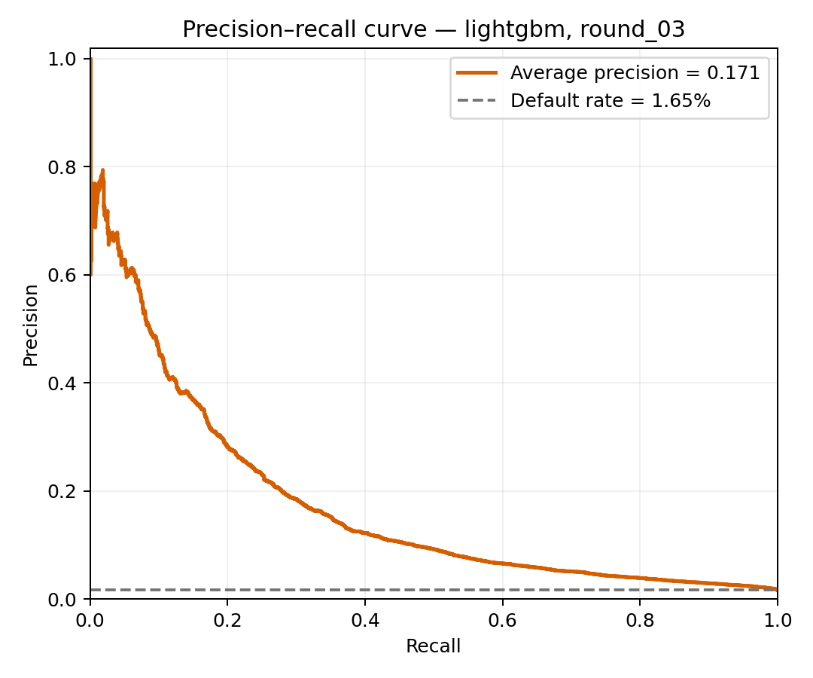
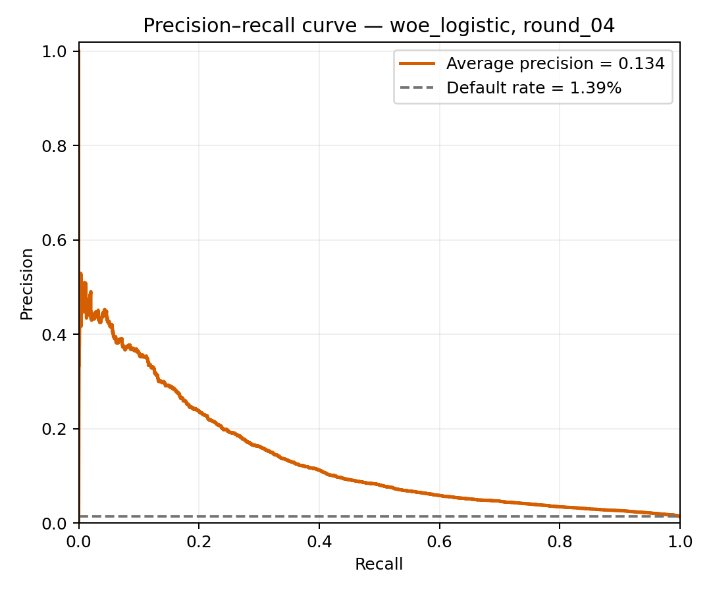
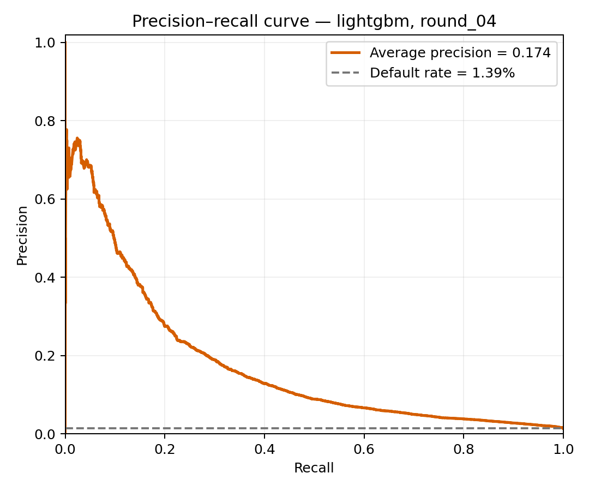

# Temporary review report: `model_test_v1`

## Scope

This is a preliminary walk-forward comparison of the unbootstrapped WoE +
logistic-regression scorecard and monotone LightGBM models.  It uses all four
existing rounds and the precomputed `features_train.csv`,
`features_validation.csv`, and `features_test.csv` files.
<!-- 
For every round, the WoE/logistic model selects its regularisation strength on
validation data.  LightGBM uses validation data for early stopping.  A Platt
calibrator is then fitted on the validation predictions and applied unchanged
to that round's test predictions.  No test labels are used in fitting or
calibration.

This is a review artifact, not the final model-selection report.  In
particular, hyperparameter searches are intentionally small and validation is
currently reused for both model selection/early stopping and calibration. -->

## Test-set results

`Calibration gap` is mean calibrated PD minus observed test default rate;
negative values mean the model underpredicts the test-period default level.

| Round | Model | Observed DR | ROC-AUC | PR-AUC | Mean calibrated PD | Calibration gap |
| --- | --- | ---: | ---: | ---: | ---: | ---: |
| 1 | WoE/logistic | 1.21% | 0.8136 | 0.1064 | 0.86% | -0.34 pp |
| 1 | LightGBM | 1.21% | **0.8219** | **0.1296** | 0.83% | -0.38 pp |
| 2 | WoE/logistic | 1.58% | 0.8211 | 0.1726 | 1.55% | -0.03 pp |
| 2 | LightGBM | 1.58% | **0.8288** | **0.2089** | 1.45% | -0.13 pp |
| 3 | WoE/logistic | 1.65% | 0.8118 | 0.1450 | 1.43% | -0.22 pp |
| 3 | LightGBM | 1.65% | **0.8247** | **0.1715** | 1.44% | -0.21 pp |
| 4 | WoE/logistic | 1.39% | 0.8315 | 0.1345 | 1.40% | +0.01 pp |
| 4 | LightGBM | 1.39% | **0.8447** | **0.1744** | 1.48% | +0.09 pp |

**Calibration note.** Each model is fit on its training split.  The validation
split is used for WoE/logistic selection or LightGBM early stopping, then its
raw PDs and labels fit a Platt mapping,
\(\sigma(a\operatorname{logit}(pd_{raw}) + b)\).  That frozen mapping is
applied to the test raw PDs without using any test labels.  `Calibration gap`
is mean calibrated PD minus observed test default rate; a negative gap means
the model underpredicts the default level.

## Initial interpretation

- **LightGBM ranks firms better in every round.** Its ROC-AUC improvement over
  WoE/logistic is 0.008–0.013, and its PR-AUC is also higher in every round.
- **PD levels vary across time.** Both models underpredict in rounds 1 and 3;
  round 4 is close to the observed default level.  Their calibration slopes
  stay close to 1, so changing default level—not ranking shape—is the main
  issue.
- **Treat this as an early comparison.** WoE/logistic is the simpler audit
  benchmark; LightGBM is the performance leader so far, but has not yet had a
  broad validation-only tuning search.

## ROC and PR figures

All figures are generated from calibrated test PDs.  The PR curves are shown
below because precision is especially informative for this rare-default
outcome.  The ROC curves remain in `reports/figures/model_test_v1/`.

| Round | WoE/logistic | LightGBM |
| --- | --- | --- |
| 1 |  |  |
| 2 |  |  |
| 3 |  |  |
| 4 |  |  |

<!-- ## Suggested next checks

1. Review the curves and the model-specific PD-decile tables in
   `model_artifacts/model_test_v1/round_XX/<model>/metrics.json`.
2. Decide the final, validation-only LightGBM tuning grid before treating its
   reported test advantage as a final selection result.
3. Decide whether calibration should remain Platt-only or compare isotonic
   calibration through a stricter internal calibration split / out-of-fold
   procedure.
4. Add explanation artifacts next: WoE-bin scorecard tables and LightGBM SHAP
   summaries or monotonicity checks. -->
